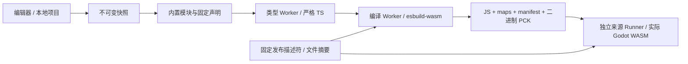

# 纯浏览器 TSX Playground

运行时不依赖 Node.js、WebContainers 或编译服务。Node.js 只用于开发、准备静态发布文件和 CI。页面源码位于 `apps/playground`，浏览器实现位于 `scripts/jsb.react-browser`。

## 已实现的链路

1. 多文件编辑、固定内置依赖、文件和资源管理、IndexedDB 自动恢复、JSON 导入导出及压缩 URL 分享。分享项目不会自动执行。
2. 冻结源文件和配置，生成内容身份。构建站点时预打包 clsx 并整理声明，React/SDK/scheduler 使用固定运行包；浏览器仅通过内置映射和本地文件加载模块，不在线解析 npm、peer、exports 或类型依赖网络图。
3. 编译 Worker 加载已验证的 esbuild-wasm，独立类型 Worker 运行完整严格 TypeScript 检查，支持诊断、补全和 hover DTO。检查回执必须属于当前冻结构建。
4. 复用 Node 构建器的 canonical imports、动态模块门禁和启动代码。React、SDK 和 scheduler 保持单实例。浏览器生成 CJS、source maps、manifest 和二进制 PCK v3。
5. PNG/JPEG 在浏览器解码为封闭 ImageTexture；严格 `.tres` 子集直接封装，不调用编辑器 import pipeline。
6. 独立来源的预览 iframe 经 MessageChannel 接收 PCK。每次运行拥有独立 runId、状态和期限；校验引擎 JS、压缩 WASM 及解压后 WASM 后加载实际 Godot。
7. 重跑、停止、失败和取消有独立退出分类。类型检查失败保留上一个成功预览。页面提供 Counter、Context、图片/UI、物理与错误诊断示例。

## 架构与身份



`buildKey` 绑定源文件、配置、内置模块内容、运行发布版本、SDK 模式、profile、编译器、TypeScript 和检查策略。generation 使用内容身份；runId 区分相同产物的多次运行。旧回执和旧 iframe 事件不能覆盖当前结果。

`release.json` 同时记录实际引擎 target、单线程配置、Git 来源与实际输入哈希、构建配方、React/ABI/profile tuple、SDK 双模式、类型声明、编译器和引擎资产。SDK 的 production 模式不表示引擎采用 `template_release`。

发布候选、源码来源验证、指定范围的浏览器验证、npm 上传和 CDN 验证是分开的状态。`certified` 只描述其证据中的浏览器和能力范围。完整描述符也被页面单独固定 SHA-256，避免认证元数据被独立替换。

## 能力边界

| 能力 | 当前策略 |
| --- | --- |
| `core-ui-v1` | 核心 UI、事件、ref、React hooks 与组合组件 |
| `ui-media-v1` | 六种额外宿主、PNG/JPEG Texture2D、受限 UI 属性 |
| `behavior-physics-v1` | 实际 GodotPhysics2D、frame commands、失效 token 拒绝 |
| 模板/任意 TSCN | 关闭；原生 SceneState 校验和可信发布绑定完成前拒绝 |
| 运行时 npm 加载 | 关闭；仅支持内置 React、Godot SDK、scheduler、clsx 的固定版本，未内置包/版本明确报错 |
| 音频 | 主 Runner 显式使用 Dummy；独立 AudioWorklet 生命周期探针不代表可听输出已认证 |
| 热更新 | 完整隔离重启；不保留上次引擎实例状态 |
| 同来源 iframe | 默认拒绝；生产应部署到独立来源 |
| 无限循环 | 有期限并尝试销毁 frame；浏览器线程/进程调度决定能否抢占，不承诺任意代码可中断 |

原始场景、脚本资源、间接 PackedScene、伪造预验证证书、任意原生属性透传和未闭合动态模块加载都不会进入默认能力面。详细 npm/资源边界见 `scripts/jsb.react-browser/README.md`。

## 开发与验证

页面打开或刷新后，在运行环境就绪并恢复本地项目后自动构建并运行；切换示例、重置或导入项目也会自动运行。构建失败会展示诊断并恢复运行按钮，停止操作会取消本次自动启动。分享链接首次打开仍需检查后手动运行。
页面支持拖动调整编辑器、预览和底部面板的大小，布局偏好保存在当前浏览器。
顶部「示例项目」菜单可用方向键选择、Esc 关闭。新项目默认使用「星际补给站」；已有本地项目仍按原样恢复，载入示例或重置后可体验新默认项目。

| 示例 | 玩法与学习内容 |
| --- | --- |
| 星际补给站 | 采矿、钻头升级、自动采矿无人机、暂停与重开、累计 120 矿石通关；多文件组件、useReducer、计时器清理、Suspense 图片加载 |
| 小队编成 | 在 5 点能量预算内招募队员，达到 80 战力后发射；Context、受控 Toggle、稳定 key 与派生状态 |
| 像素素材实验室 | 三张原创 PNG、镜像、缩放、配色切换；useAsset、TextureRect、原生控件与资源文件 |
| 弹跳实验场 | 可见小球与封闭碰撞场地，发射冲量、地月重力、暂停与重置；实际 GodotPhysics2D、React HUD 与引擎属性所有权 |
| 多文件计数器 | 简洁的状态更新、ref、组件拆分与内置 clsx 入门 |
| 类型与错误诊断 | 主动修复示例中的类型错误，练习源码定位 |

四个场景项目附带可编辑 README，说明操作方式和修改练习。像素素材为本项目原创，可通过 `python apps/playground/examples/generate_art.py` 重建。
页面标题为 GodotAI Playground，工作区参考 VS Code 的深色布局。资源管理器按目录展示文件，支持类型图标、折叠全部、方向键导航和搜索时展开匹配路径。文件操作使用右键菜单、Shift+F10 或每行「⋯」，支持重命名、复制路径和删除；入口文件与最后一个文件禁止删除。桌面通过项目菜单或 `Ctrl/⌘ + B` 控制文件面板，手机使用「文件」入口。内置依赖与运行设置保留在文件面板底部。
文件搜索和可关闭标签页只改变编辑视图；切换文件会保留光标与滚动位置。
「内置依赖」只读展示固定版本：React 19.3.1、`@godot-js/react` 0.1.0、scheduler 0.28.0、clsx 2.1.1，全部可以直接 import。不提供添加、删除或版本编辑入口。项目文件列表不再包含 package.json；恢复或导入旧项目时移除依赖清单与锁文件，源码保持原样，并统一使用站点内置版本。导出配置中的 dependencies 仅用于兼容通用项目格式，重新导入时仍恢复固定内置版本。
编辑器使用随站点打包的 Monaco 0.55.1，包括语法高亮、撤销、查找、代码折叠、括号匹配和逐文件模型。编辑器 Worker 与字体由本站提供；诊断标记、补全和悬停使用固定本地声明与既有的冻结项目 TypeScript Worker，避免重复维护另一套类型环境。过期的语言查询不会更新当前视图。
控制台支持按级别筛选、复制和暂停跟随输出。构建期间也可以点击停止。

`Ctrl/⌘ + B` 切换项目面板，`Ctrl/⌘ + Enter` 运行，`Ctrl + Space` 请求补全。
预览右上角可以进入专注模式；按 Esc 或再次点击该按钮返回编辑布局。
调整布局不会重建正在运行的引擎实例。窄屏使用项目抽屉和上下分栏，运行时自动进入专注预览。

```sh
pnpm install --frozen-lockfile
pnpm build
pnpm test:react
pnpm test:browser:unit

# 需要实际 Godot Git 源码和激活的 Emscripten 4.0.11。
pnpm browser:engine --godot-source /path/to/godot --build-dir /independent/build --out /artifacts/engine.json --target template_debug --jobs 4
pnpm browser:prepare --engine-report /artifacts/engine.json --out /artifacts/site
pnpm playground:serve --site /artifacts/site

# 静态站点从两个不同来源提供相同构建；测试工具只提供 GET/HEAD。
PLAYWRIGHT_MODULE=/path/to/playwright-core/index.mjs CHROMIUM=/path/to/chromium \
  pnpm test:browser:real --site /artifacts/site --out /artifacts/integration
PLAYWRIGHT_MODULE=/path/to/playwright-core/index.mjs CHROMIUM=/path/to/chromium \
  pnpm test:browser:stress --site /artifacts/site --out /artifacts/stress --iterations 100 --failures 20
```

压力测试记录每次运行与退出，区分正常退出和强制移除。父页 JS heap 和 DOM 只是观测值，不证明完整 WASM/native allocator 零泄漏。源码映射专项位于 `tests/browser-preflight/verify-source-maps.mjs`。

`.github/workflows/browser-playground.yml` 包含源码构建、旧预验证、完整 Playground、压力验证及 npm-pack 外部消费者检查。可通过 `BROWSER` 选择共享测试驱动支持的浏览器；是否通过以实际报告为准。

## 静态托管与 npm 交付

用 `browser:prepare --preview-url https://独立预览来源/preview.html` 写入预览地址。部署编辑器与预览时保持引擎资产路径一致；也可以让固定 release 和引擎资产统一来自 jsDelivr。部署需要 HTTPS 或本机可信来源、WebGL2、WASM、Workers、Blob module、gzip DecompressionStream；不要求 COOP/COEP 或 SharedArrayBuffer。

私有静态托管使用当前来源的登录态加载描述符、编译器及引擎文件；跨来源 npm/CDN 请求不携带该登录态。身份门禁由托管方处理，项目不生成绕过访问控制的令牌。

发布工具默认输出 `godot.wasm.gz` 并记录压缩前后摘要和长度。浏览器自行限额解压，不依赖托管方自动设置 Content-Encoding。每个资产必须符合托管服务的单文件限制。

通用 npm 解析器保留为浏览器库的独立适配接口；Playground 使用 compiler-core 与 builtins，编译 Worker 不包含通用解析器或 npm transport。新增内置库需要更新 `apps/playground/builtin-catalog.json`、构建期预打包与声明映射，再构建发布站点。引擎固定发布包仍可发布到 npm/jsDelivr，与用户项目在线安装依赖无关。

完整的准备、绑定验证报告、npm pack 安装验证、npm 发布与 CDN 逐文件复验命令见 `scripts/release/README.web.md`。实际发布需要对 `@godot-js/web-engine` 有权限的 npm 身份；缺少凭证时工具失败并保留报告，不会把本地包标成已上传或已由 CDN 提供。
