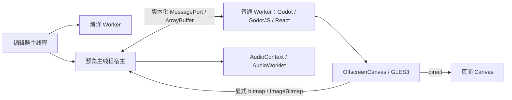

# GodotJS Worker 执行与交付契约

## 当前开发阶段与评审口径

当前框架处于初步搭建阶段，仍会持续大范围重构，不用过度追求边界。评审优先关注构建、启动、渲染、输入、停止重启和异常隔离等主流程，以及模块职责和后续重构成本。内部接口可随实现协调调整；极少见异常分支、完整浏览器/设备矩阵、严格性能预算及验收工具加固可按需后补，不作为每次框架迭代的前置条件。

本阶段统一遵循 [框架开发与评审原则](../CONTRIBUTING.md#framework-development-stage-and-reviews)。已知缺口保留为后续工作，不改写成已修复或已验证；下文的完整发布验收要求不作为当前所有开发任务的准入门槛。

2026-11-14 按此口径复核：未发现阻塞继续开发的主流程或架构问题。R23（[普通套件的异常退出证据校验](../apps/playground/scripts/runtime-evidence.mjs)）和 R24（[失败探针及旧报告采纳](../apps/playground/scripts/worker-capability-matrix.mjs)）保留为非阻塞的验收工具加固项，待依赖这些报告作稳定化或发布决策时再完善；R23 原先的 P1 定级不作为当前迭代的阻塞依据。

## 执行架构

本次实现把 Godot、GodotJS、React 协调和原生对象句柄放进同一个普通 Dedicated Worker。主线程提供 DOM、输入、呈现和音频宿主。音频设备由主线程 AudioContext/AudioWorklet 驱动；这不把 React 移回主线程。传输仅使用结构化消息与可转移 ArrayBuffer，不要求 SharedArrayBuffer、Atomics、COOP 或 COEP。



默认请求 `direct`，把 canvas 转移给 Worker 内的 GLES3/WebGL2。`bitmap` 必须显式选择，使用有额度限制的 ImageBitmap 呈现。不会因一次 WebGL 失败自动改用另一个执行后端，也不新增上线时 WebGL 探针或首帧探针。当前产品只提供 Worker 执行；legacy 预览页面、build/dev 命令和执行参数均已移除。普通 `build` / `dev` / demo 直接使用 Worker，`--worker-execution` 和 `:worker` 命令仅保留为同义入口。此产品策略变更由用户明确要求，不代表三浏览器、性能或设备验收已经通过。

bitmap 的单帧额度同时约束原生绘制：上一张图仍未收到精确匹配的消费 ACK 时，原生循环继续执行脚本、物理和计时，只抑制普通画面的 draw。被抑制绘制的时间累计到下一次实际 draw，保持 shader 时间连续；项目自己关闭渲染的意图仍然有效。resize 不伪造额度，旧 epoch 的正确 ACK 仍可归还原 ticket，错误 ACK 不放行。XR 使用自己的帧节奏并绕过普通画面的额度门。消费 ACK 证明宿主已消费或释放 ImageBitmap，不证明物理显示器已经显示该帧。

## C20 冻结历史证据与修复范围

下文 C20–C27 数字及入口策略均是冻结历史记录，不为新源码作证；当前 Worker-only 产品策略以本文顶部为准。C20 当时普通 build/dev 已恢复 legacy 默认；Worker 使用 `--worker-execution` 或 `build:worker` / `dev:worker` 显式选择，默认切换仍需 GO。

协议与身份、Worker 加载和生命周期、两种呈现、音频、输入及宿主桥接、构建交付与验收工具六个工作包已实现。原生两阶段启动、退出音频对象释放、位图绘制背压和 RTC 句柄销毁均进入 checked patch；两个 profile 各自 debug/release 四套模板已从当前补丁实际构建，并绑定十个原生源码路径。React 协调与用户脚本随引擎运行在 Worker 中。

C20 当时源码的相关单元测试为 644 项通过、0 项失败，另有 1 项须单独启用浏览器 GPU 的用例；该 GPU 用例已在独立虚拟 XR 工程验证中通过，不代表实体头显验证。宿主功能以实际 Godot 调用覆盖 direct/bitmap、snake/camel 与 development/production 八种组合；各候选的完整产品验收和发布仍由下面的严格门禁决定，不能用局部通过替代。

当前 Playground 严格 TypeScript 检查通过，包含 Worker 与两种预览入口。四个 C20 候选的两种呈现共八份 Chromium runtime 报告已通过独立完整校验：520 个真实 Native 会话均退出 0，宿主/音频清理、会话身份、生命周期压力和 Worklet 字节证据均满足要求；这是 runtime 范围的结论，完整矩阵与能力门禁另行评价。

四目标正式矩阵已完整执行 92 套，68 套通过、24 套失败；68 个原始通过报告全部通过独立的真实封印规则逐项复核，编辑器与交付仍按各自 scope 检查：

| 候选 | 通过 | 失败 |
| --- | --- | --- |
| full debug | 16 | 4 |
| full release | 16 | 4 |
| 2d debug | 18 | 8 |
| 2d release | 18 | 8 |

Chromium 的 64 个核心套及四个 2D 专项套全部通过。Firefox 的实际 Native 会话可完成，但旧 Wasm EH 指令、提前布局和 compiler worker 不可达代码警告使 runtime 严格检查失败，2D 专项亦因 EH 警告失败。当前 Linux Playwright WebKit 的默认 Worker 渲染无法启动，runtime 和 2D 专项均保留失败；这一结论不推广到 Safari/iOS。Worklet 字节独立审计的 16 份可观测序列通过，八份 WebKit 缺完整帧，保持未评价，不认证为通过。

真实发布门禁已执行：工程实施为 `go`，默认切换与发布均为 `blocked`，四个站点均首先被 Firefox runtime 失败阻断封印。能力 inventory 按 full/2d 的 32/30 项、每项 24 种组合保留要求，当前专用同批通过 probe 为 0；泛测试报告不能充作逐能力证据。固定性能预算的六项失败也继续阻止性能放行，独立性能证据完整性通过不改写预算结果。

本次没有把旧 SDK 构建、旧引擎报告或先前的浏览器实验当成新版本通过证据。新源码构建、两种 profile、两种 presenter、浏览器及 SDK development/production、snake/camel 命名的实际结果均以对应候选报告为准。缺少任何必要能力证据时，默认切换和发布仍为 **blocked**。

当前 C20 / Native v6 候选已完成八种宿主组合：56 项通过，8 项剪贴板读取因实际权限受阻，0 项功能失败。HTTP、WebSocket 与 JavaScriptBridge 的两种呈现验证通过。两种呈现的集成验证各 9 项通过，包含三次真实中文输入法组合、拖放、React 状态、上下文丢失后新 Worker 及强制停止。原生 RTC 的连接销毁、重新初始化、迟到回调屏障和清理通过，但环境 UDP 策略使真实数据通道连接仍为 blocked。Native XR 的 7 项检查与独立 GPU 用例通过，使用虚拟 provider 和软件 GL，仅为工程证据。

C20 的十二组独占性能测量已全部完成，四个候选均使用各自的新 Legacy 基线，服务健康检查十二次通过，固定规则为 122/128 项通过：

| 候选 | direct | bitmap |
| --- | --- | --- |
| full debug | 16/16 | 15/16 |
| full release | 16/16 | 16/16 |
| 2d debug | 15/16 | 15/16 |
| 2d release | 15/16 | 14/16 |

六项未通过结果保留：full debug bitmap 与 2d debug 两种呈现的 lights 应用 FPS 均为 12，低于各自 12.35 的门槛；2d release direct 的 lights 启动 p95 为 15.55 秒，门槛为 7.21 秒；2d release bitmap 的 shader/dungeon 启动 p95 为 7.75/7.00 秒，门槛为 4.91/4.89 秒。应用 FPS 是 Native 遥测，不证明物理显示帧率。全部 WASM 容量与 3000ms 停止限制通过；容量为实际线性内存的分配容量，不能据此推断 live allocation 或泄漏。门槛失败仍阻止性能放行，不通过扩大预算、改用旧基线或挑选重测结果消除。

C15 的历史性能结果为 123/128，原报告及失败样本继续保留，但不为 C20 新字节作证。性能与独立音频审计分别评价，不能互相替代。

## 三层身份与版本

1. 原生 build report 必须是 `built`，并带 `runtimeAbi` 和 `workerPatch`。全部原生文件的 checked patch 回执必须与 recipe、补丁实现哈希及实际源码快照逐项一致。文件清单直接从原生 patcher 的 `WORKER_RUNTIME_PATHS` 共用，包含拖放完成屏障，避免构建器与验收端各维护一份清单。`snapshotted` 状态或给旧模板补一个 ABI 常量都不能组装 Worker release。
2. `engine-release.json.runtimeAbi` 固定 `{protocolVersion:2,host:1,audio:1,presentation:1}`，进入 release ID。原生 JS/WASM、原生 worklet、SDK、API 与类型继续进入同一不可变 release 身份。
3. 站点 `manifest.json` 使用 schema 3，额外绑定 `preview.js`、`runtime.worker.js`、`runtime.audio.worklet.js` 的原始字节哈希及大小，并声明支持 `direct`/`bitmap`。候选 ID 是完整 manifest 原始字节的 SHA-256；最终 siteHash 在外部验收回执记录。不能把 candidateId 再回填 bundle 或 manifest，避免哈希循环。

一次验收批次使用 `acceptanceBatchId`。每次实际预览另有 `runId`、`documentId`、`workerId` 和 `runConfigurationHash`。后者按公共协议固定字段顺序及排序后的 budgets 计算，包含执行后端、呈现后端、ABI 和预算。批次 ID 不能冒充 session ID；schema 2 报告不能给 schema 3 候选作证。

预期 React 错误的证据必须绑定实际项目入口 `sourcePath`，并在真实日志中保留该路径、错误标记和已完成的宿主清理；不能假定所有项目入口都叫 `App.tsx`。权限断言依据浏览器可识别的声明检查，Worker 的 fullscreen/microphone 委派和实际音频生命周期仍为必需项。Worklet 的 200 响应记录实际字节，校验器重新计算 SHA；真实 304 响应必须引用更早的同 URL、同强 ETag 的实际 200 字节证据。304 不冒充新下载，不关闭 HTTP 缓存，也不以额外 fetch 替代该响应。缺失种子、ETag 不匹配、其他 URL、未来证据、错误字节及真正的重定向均拒绝。

故障会话的 iframe 快照与退出回执可能先后到达，iframe 销毁也可能使最后一条 console 观测丢失。验收观察器因此在持久父页被动记录真实原生 MessagePort 的 `connected` 与 `exit-report`，并按同一端口及完整七项身份关联。`terminalObservation` 保留原始快照、原始回执和两侧观测时序；`exit` 精确取自真实回执，原始 `workerState` 和音频字段保持不变，不能将较早的 `audio.closed=false` 改成 `true`，也不能给强制终止补一个 Native exit 0。观察器不改变消息内容、不调用 `start()`、不回复或 ACK、不增加浏览器 RPC；原生构造器、品牌、getter 和产品回调保持。矩阵在每套测试报告生成后立即运行独立证据校验，再决定该套是否通过；编辑器和 HTTP 交付按其非引擎 scope 校验。

构建时把三套共享 SDK 重新 emit 到内存并与冻结的 JS、声明及 maps 逐字节比较；React 的生成 wrapper 与两种 reconciler bundle 也按原 recipe 重算。该检查不写共享 dist，可拒绝旧编译代码配当前源码 map 的情况。source/output proof 进入 release；组装末尾再次确认共享输入和输出未改变。封印另校验 runtime bundle source map 内所有仓库源码与当前检出的真实源码，覆盖 SDK 导入，不能只比较一个入口 wrapper。测试后候选任何字节改变都必须开启新批次。

## 构建和验收

先统一构建并冻结共享 SDK，再并行构建独立 profile/target 原生模板。禁止多个 site 构建同时改写同一 SDK dist。普通 site 输出使用 `dist`、`dist-2d-debug`、`dist-2d-release`、`dist-full-release`，也可用 `--out` 指定独立位置。构建会清除输出中残留的旧预览页面及压缩变体；旧 legacy 站点不能只刷新前端，必须完整重建。

```sh
pnpm build
node apps/playground/scripts/build.mjs --worker-execution --engine-report /absolute/new-engine-report.json --skip-sdk-build --out /absolute/site-worker
node apps/playground/scripts/prepare-site-delivery.mjs /absolute/site-worker
node apps/playground/scripts/worker-acceptance-matrix.mjs --site /absolute/site-worker --out /absolute/reports-worker --plan
node apps/playground/scripts/worker-acceptance-matrix.mjs --site /absolute/site-worker --out /absolute/reports-worker
```

矩阵 runner 消费已冻结的候选，不重建 SDK。核心八套产品测试在 Chromium 两种 presenter 下执行；两种 profile 都要求三浏览器两种 presenter 的 runtime 压力测试；2D 另要求三浏览器两种 presenter 的资源/功能验证。Chromium 至少 50 次额外真实音频生命周期，Firefox/WebKit 各至少 2 次。报告名含 suite、worker、presenter 和 browser，避免覆盖。

浏览器版本、平台和实际启动参数进入报告。SwiftShader、软件 GL 环境变量、native hook、修改浏览器特性的参数及 fake media/XR test 参数属于 `environment-override`，可用于工程定位，不能混作默认浏览器设置的封印。环境只记录白名单标志；`LD_PRELOAD` 等只记录存在布尔，不输出任意路径或完整环境变量。Xvfb/显示服务与 Pulse null sink 单独作为环境元数据记录。`PLAYGROUND_BROWSER_DEFAULT_SETTINGS=1` 移除测试预设的 SwiftShader/自动播放参数；平台仍必须提供真实可用的图形/音频环境。Linux Playwright WebKit 证据只证明该构建，不证明 Safari、iOS 或所有 WebKit 产品。

`.github/workflows/browser-playground.yml` 的默认原生 CI 是两个 profile × `template_debug`/`template_release` 共四目标，分别构建、交付、执行完整矩阵并保存独立 artifact。手动 dispatch 可选择单 target 诊断；该诊断缺失的目标仍使四目标 rollout 汇总保持 blocked。默认产品验收不设置 `LIBGL_ALWAYS_SOFTWARE`，不加入自动播放绕过参数；旧 compatibility conformance 的显式软件 GL 测试保持独立，不能替新产品默认设置作证。不可用的浏览器或图形环境产生失败证据，matrix runner 继续收集其余项，不能跳过后宣布通过。

手动启用 `measure_performance` 后，每个目标可通过 `performance_baseline_run_id` 下载独立冻结的历史站点，再用当前测量工具采集 legacy 基线，再分别生成并执行 direct/bitmap 的固定回归预算；缺少独立旧站点时只测量两种 Worker 呈现，回归验收保持 not-evaluated，direct 失败仍采集 bitmap。四目标 `rollout-summary` job 无论上游成败均尝试汇总 artifact，重新验证封印、能力 ledger/probe、基线原始哈希、两套预算及性能身份。预算的采样参数和硬件约束必须一致，运行负载观察保留为事实，不伪装成恒定值。缺 artifact、能力证据、性能或目标时输出明确 blocked 的 `worker-rollout-summary-<commit>` artifact。默认不运行性能因而不能得到发布 GO；该汇总 job 不执行发布，也不会把工程默认 Worker 等同于产品发布批准。

验收日志使用单向被动 recorder：页面同步 `console.debug` 发送私有 nonce 和有界 JSON，Node 仅读取 console 文本，不通过 Playwright binding/evaluate 回复页面。原先 `exposeBinding` 的返回路径会给 Chromium 制造用户激活，不能用于证明自动播放/XR 的无点击边界。独立真实浏览器测试在多次 top/iframe 记录后用 `userGesture:false` 的 CDP 观察确认激活仍为 false，真实点击后才变为 true；CI 也执行该测试。常规产品交互测试中的 Playwright 求值不自动成为无手势负例证明，需使用独立被动观察测试。

## 能力 ledger 与 GO gates

完整能力清单由 [worker-capability-ledger.mjs](../apps/playground/scripts/worker-capability-ledger.mjs) 管理。基线取公开文档/API 契约与实际产品能力的并集，保留通用 2D 的 WebSocket、WebRTC、资源格式、麦克风及浏览器宿主操作。不能把尚未桥接的 API 标为 out of scope 来通过验收。原生对象或任意同步 DOM 透明互操作在无 SAB 的异步边界上不作兼容承诺；通过明确的 host ABI 版本交付该边界；不再提供 legacy 回退。

ledger 将 3D 与 WebXR 分开，并分别列出 clipboard、fullscreen、pointer lock、file dialog、拖放、download、URL、gamepad、MIDI、vibrate、PWA、TTS、IME 和 accessibility，不能用一个宽泛的宿主 demo 替代所有契约。每项采用 `native-usable`、`bridged`、`original-platform-unsupported`、`versioned-change` 或 `pending-bridge` 分类。后者阻止默认切换；版本变化只适用于已明确约定的同步 DOM 不支持及 legacy 入口废弃边界。

每个 case 还必须引用专门的 `worker-capability-probe` 原始报告，绑定该能力名称、分类、浏览器、presenter、SDK mode、命名、真实 session/config 身份以及验收批次记录的 producer 源码哈希，并保留非空原始观察和实际检查结果。一个泛 demo 的 passed 报告不能被重复引用成 MIDI、TTS 等能力已经验证。

硬件相关的正例也必须保留实际事实：WebXR 为 immersive session、真实提交帧及原生 view 帧和退出；麦克风为非零输入及关闭；MIDI/gamepad 为设备事件到原生事件及清理；vibrate 为实际设备/请求；TTS 为声音、完成/取消和原生回调。仅发现 API 名称或跑一个无设备的 inline XR session 不代表这些能力已通过。

`original-platform-unsupported` 需要同一原生候选的显式 legacy 基线、完全一致的浏览器构建/平台/默认设置，以及可重新哈希的 native probe 负例，保留原生与浏览器两侧原始观察。只允许 API 原本未暴露或原生平台明确不支持的结果；缺硬件、权限/策略拒绝、环境异常和迁移后待桥接都不能冒用该分类。例如 Firefox 原本没有 WebXR API 可凭确切基线证明；Chromium 当前没有 XR 硬件应标记 blocked，Worker 中新出现的 `navigator.xr` 缺失也不能被当成原平台限制。

| 决策 | 必需条件 | 当前证据解释 |
| --- | --- | --- |
| 工程工作包开工 | 协议/身份/预算和责任边界已固定 | 可以，独立实现与测试不必等完整矩阵 |
| 某个候选通过产品测试 | exact-source 新原生构建、schema 3 站点、固定矩阵和完整清理证据 | 由对应 receipt 决定；单测不代替 |
| Worker 默认切换 | 上述通过，加全部公开能力 ledger；所有支持的 profile/target、命名与 SDK 模式完成兼容验证 | 缺能力桥接或证据即 blocked |
| 发布 | 默认切换门槛、不可变交付验证、浏览器支持策略及性能预算通过 | 测量完成不等于发布批准 |

`worker-rollout-gates.mjs --configuration JSON --out JSON` 读取候选集合并执行上述默认切换门禁。配置中的 `candidates` 每项提供 `site`、`reports`、`capabilities` 和 `performance` 路径；完整集合必须包含两个 profile 各自 debug/release 目标。能力报告使用同一 batch/candidate 身份，并提供三个浏览器的实际版本/默认设置、能力、presenter、SDK mode、命名及可重新哈希的原始 evidence 文件。平台本来不支持的 API 需证明既有公开平台边界，不能把迁移造成的新缺失写成平台限制。门禁不会创建、上传或发布任何产物。

Work packages 可并行开发。真正的串行依赖只有：冻结 SDK → 原生构建/API 捕获 → 站点组装 → 传输变体 → 开始批次 → 实测 → 封印 → GO 评估。两个 profile 的构建与候选矩阵可在独立目录并行；direct/bitmap 的测试不应改写候选。

## Host ABI 1 的宿主操作边界

`OS.shell_open` 在收到 Worker 请求时立即检查主线程的真实临时用户激活。没有激活便明确拒绝，不把旧请求留给下一次点击。通过检查后，HTTP(S)、`mailto:`、`tel:`、`sms:` 及合法自定义外部 intent scheme 交给浏览器的 `window.open` 处理，并使用 `noopener,noreferrer`。宿主禁止 `javascript:`、`data:`、`blob:`、`about:`、`file:`、`vbscript:`、`filesystem:` 及浏览器内部/扩展 scheme，防止请求在主线程装载可执行内容或本地内容。这是 Host ABI 1 的跨 realm 策略边界，不冒充原浏览器“不支持”这些 URL。浏览器可能自行拒绝外部应用或弹窗。

Worker 预览 iframe 声明 `allow-downloads`、`allow-popups` 与 `allow-pointer-lock`，并向独立预览 origin 委派 clipboard read/write、fullscreen 等宿主能力。声明只解除预览容器自身的阻断；实际浏览器权限、用户激活检查和宿主额度仍然适用。宿主能力测试通过真实 Godot 调用观察浏览器效果及清理，并保留无手势拒绝负例；浏览器拒绝或缺少实际设备时报告 blocked。

权限声明优先采用浏览器 `featurePolicy.features()` 已识别的集合。当前 Firefox 没有该查询接口，且不识别 autoplay、MIDI、XR 和剪贴板的 policy token，因此该环境只声明 fullscreen 与 microphone；省略被忽略的 token 不禁用对应 Host API。全屏镜像保留 canvas 为事件 target、document 为冒泡阶段 currentTarget，使 Godot 官方回调能够更新原生窗口模式。无手势全屏请求的拒绝以真实、同端口同 requestId 的 Host command/result 作证，不将上游静默捕获 Promise 拒绝误记成浏览器已允许。

文件拖放使用真实 DataTransfer/File 和异步目录项镜像。每次最多 64 MiB、1024 个文件、2048 个文件/目录项，深度最多 16，路径元数据累计最多 1 MiB；目录枚举和 Worker 处理分别有 15 秒期限。同一 run 只允许一笔原生拖放事务，待原生读取、回调、临时 FS 清理及最终完成回执后归还额度。官方 Worker 固定 `persistentDrops=false`。停止先撤销输入，再执行原生清理；迟到的文件读取不得继续写 FS 或调用原生回调。超限、并发事务及不安全路径均明确拒绝。

Worker 的 `window` 只提供版本化 DOM ABI；其余可用 Worker 全局对象保持原身份，例如 `Array`、`JSON`、`Promise`、WebSocket 和已桥接的 RTCPeerConnection。原生 canvas 仍是真实 OffscreenCanvas 事件目标。无法维持同步阻塞语义的 `alert` 明确抛出 `E_WORKER_UNSUPPORTED_SYNCHRONOUS_ALERT`；任意同步 DOM 透明互操作不受支持，不提供旧执行入口回退。

WebRTC 的实际连接和数据通道由 Host 持有。原生 `WebRTCPeerConnection` 销毁或重新 initialize 时，Worker 路径必须明确关闭旧连接；仅清空回调和移除原生 JS 句柄不能释放 Host 强引用。待决 SDP/ICE 完成后，只有原句柄仍指向同一连接且连接未关闭时才允许进入原生回调，避免旧结果触及已释放或重新初始化的对象。DataChannel 保留上游明确关闭路径。真实原生用例另检查重新初始化、待决操作后关闭、确定性的原生 Ref 释放、Host 私有表归零及正常退出；SDP 成功不代表受网络策略限制的数据连接已建立。

## Audio ABI 1 的输入调度容量

输入传输池保留最多 8 个官方默认 loan，格式固定为双声道，与扬声器输出的 1/2/4/6/8 声道无关。启动前根据实际 AudioContext 采样率与项目 latency，按原生相同的 nearest-power-of-two 算出 driver ring 帧数 R；每个 capture block 为 `ceil(max(256, ceil(R/8))/128)*128` 帧，单块最多 16384 帧。池至少覆盖一个 `R/sampleRate` 的 driver 周期，不把多声道 output-sized input_rb 的全部物理空间当成额外输入时长。输出 ring、项目 latency、设备 hint 和 mix rate 均保持原值。

Native 双 ring、固定双声道 history、输出传输与新输入池的 PCM 字节全部在 setup2 前准入。48kHz / 75ms 时 R=4096，输入池为 8×512 帧，capture 为 32768 字节，总 PCM 为 262144 字节；不足预算立即拒绝并关闭已建 AudioContext。超过有界输入容量而 loan 尚未归还时，Worklet 丢弃新输入并增加 `inputDroppedFrames`，不保证任意调度延迟下零丢帧。

极低 latency 的既有边界仍须区分：R<64 时最小 block 256 帧可能超过 Native history 的 4R 帧。分段复制和回调保证 staging ring 内存安全，但不代表该极端配置的原生 history 无损，也不通过改写项目参数或增加异步混音改变其语义。当前 48kHz / 75ms 验收针对完整 4096 帧 driver 周期的输入覆盖。C20 以原生产者源码及项目参数完成一轮独占测量：2 秒预热后的 5004.924ms 稳态窗口内，输入丢帧与输出 underrun 增量均为 0，1888 次输出检查、非零输入及接受/真实权限拒绝两条清理路径通过；24 项独立严格审计通过，窗口内未发生 cgroup CPU 节流。这只证明虚拟设备工程链路的该次窗口，不代表物理音质或长期零丢帧。

C14 稳态丢弃 1408 帧与 C15 稳态丢弃 256 帧的原始失败记录均保留，不能改写成通过，也不再当成 C20 的当前结果。C15 同窗口观察到约 98ms 的 cgroup 节流，现有证据不足以确定其逐包原因。不能用生产者的宽松 passed 状态替代独立质量审计，也不能反复重测挑选零丢帧结果。

## Audio ABI 1 的停止屏障

音频消息与运行时控制使用独立 MessagePort，两个端口之间没有全局到达顺序。停止或故障控制一到达，Worker 先撤销本地音频准入，再请求 Native 退出；Host 的停止消息也可独立建立同一不可逆屏障。之后的 sample 注册、启动、音量、bus 和命令均停止提交，真实关闭 ACK 仍可完成。运行中的未准备状态与预算错误继续报错，不能由停止容错吞掉。

Native v6 在 `AudioDriverWeb::register_sample` 的实际 C++ 路径先检查停止取消，取消时在 playback 创建、解码与 buffer 分配之前返回。真实 Native 回归先播放并测得 sample 非零输出，再撤销 Worker bridge 并启动另一条 sample；第二次调用未进入 preflight/register，随后 Native exit 0、Host 清理完成。Workbench 的原故障流程亦重新执行通过。该回归证明停止时不会再以 `AudioHost must be prepared` 失败，不代表只调用本地 revoke 就能静音 Host，也不将该诊断中的欠载计数当成音质通过证据。

## Audio ABI 1 的 sample 计时边界

sample 的公开 position 保留既有 Web 后端语义：`playback offset + 已渲染 output frames / sampleRate`。它是 output-frame 计时，**不是 pitch-scaled source playhead**；pitch 变化不会把公开计数转换为源音频时间，循环也不会将该计数回绕。观察值来自实际 position Worklet 的帧数，不能用 Host 的 `performance.now()` 或 `AudioContext.currentTime` 伪造精确位置。暂停/恢复和 pitch 命令通过 voice epoch、command sequence 与 Worklet generation ACK 排除迟到报告。

恢复声音所用的内部 cursor 与公开 position 分离：它按实际 pitch 累计并在有效的 playback offset 到 buffer duration 区间内回绕；非法或空的 loop 区间采用 WebAudio 的整 buffer 有效区间。此规则保留上游 ended/restart 从 playback offset 重播的声音行为，不新增使用 sample loopBegin/loopEnd 的语义。全局音频 reset 需要新 Worker；同一 run 的 context resume、input stop/start 不冒充 audio epoch 切换，sample stop/start 则分配新的 voice epoch。

## 性能与内存

`browser-engine-performance.mjs` 保留冷启动、真实场景遥测、停止耗时和独立 WASM compile 样本。Worker 内存来自 Worker 内实际 `HEAPU8`/`_jsbb_` buffer 的字节容量，附真实 session/worker/config 身份；它不是 RSS。Worker JS heap 只有该 realm 暴露 `performance.memory` 时才可观测，缺失保留 `null`。页面 CDP heap 单独记录，不能冒充 Worker heap。测量过程不改候选 Worker 字节。

报告分别提供 `measurementStatus` 和 `performanceAcceptance`。不提供版本化 `--budget JSON` 时，后者固定 `not-evaluated`。预算 schema 1 要求 ID、明确的 profile/backend/presenter/browser/settingsTier scope 和 summary metric 的 min/max 规则；缺失测量不能被算成 0 来通过。预算失败保留全部样本并以失败退出。正式数值由产品目标确定，不能用一次本地样本临时降低门槛。

工程回归准入使用固定的 `worker-regression-v1`：先对独立冻结的历史站点显式 `--execution legacy` 生成冷启动基线，再用 `--execution worker --baseline legacy.json --write-budget worker-budget.json` 测量。预算在首个 Worker 样本启动前落盘，绑定基线原始文件 SHA-256，拒绝覆盖不同预算。每个场景要求启动 p95 不超过基线 110%、WASM 容量最大值不超过 115%、最大停止时间不超过 3000ms、每样本 FPS 中位数的总体中位数不低于基线 95%。引擎/SDK 实际字节、API 声明、资源包及示例执行输入必须一致，原生 target、浏览器构建、当前测量工具、硬件和采样参数也必须一致；提交和构建报告等元数据可以不同，两个站点保留各自真实 releaseId/descriptorHash/candidateId/siteHash，不将历史站点改名为新候选；任何缺失基线指标都使预算生成失败。该固定回归规则独立于产品另行设置的绝对 SLO。

## R1–R4 修复契约

音频 logical registry 与保留额度分别计账。注册先预留 transfer 副本和 Host AudioBuffer 两份字节；register ACK 只归还传输部分，精确 unregister ACK 才归还 Host 部分与样本数量额度。Native preflight 还计入解码与 planar staging 的临时峰值。注销立即反映到 Native 查询，旧 ACK、重复 ACK 及局部 revoke 不归还新注册额度。Host 的真实停止/关闭回执才可退休整代资源。这里记录资源所有权预算，不冒充 GC 或 RSS 测量。

普通构建、服务和无显式配置的预览保持 legacy；Worker 候选使用显式入口，Worker 内仍默认 direct、bitmap 显式选择，无自动回退。CI 显式构建 Worker 并在核心矩阵后生成同批 `worker-capabilities.json`。专用 probe 的原始字节、producer、身份与浏览器范围均复核；失败的 runtime 依赖和尚无 producer 的能力写入 blocked，不补造通过证据。

`benchmarkTimings=1` 是显式测量开关，进入运行配置哈希，普通运行的 `benchmarkTimingSamples` 为 0。记录有界的 Host 捕获/发送、Worker 接收/分派、真实 Native `_input` 消费，以及 bitmap 捕获、Host 消费/释放和 ACK 时间。Native 消费由测试项目真实输入回调报告，不能由 DOM 接收或 ACK 代替。跨 realm 使用各自 `performance.timeOrigin + performance.now()`；负值或无效顺序不可用，不夹成 0。捕获耗时和 ACK RTT 使用同一个 Worker 时钟，释放回执与实际消费分别记录。这些数据不证明物理输入到屏幕延迟。输入 probe 在固定 FPS 窗口后执行，不预热冷启动；不新增生产 WebGL/首帧探针。

## C21 修复验证范围

C21 单独冻结四个新候选，复用字节未变的真实 Native v6 构建。SDK、Playground、发布与服务器测试共 658 项通过，默认跳过的 GPU 专项另行启用并通过，TypeScript 检查通过。四个候选的 Chromium direct/bitmap 共八组真实运行通过，核对 520 次 Native exit 0 与 Host 清理，包含 400 次音频压力循环。128 字节预算的真实 MessageChannel 回归在第二次注册前拒绝准入，实际排队 32 字节；原 C20 积压 640 字节的失败报告保留。

当前 headless Firefox 的真实运行仍未通过 WAV 输出检查。相同浏览器、WAV 项目和实际画布点击的 C20/C21 对照均已启动 Native 并注册样本，但 AudioContext 始终 suspended、输出检查数为 0；该对照没有显示本轮额度修复引入此失败，也不能据此宣称所有 Firefox 音频都不支持。Linux WebKit 本轮初始化未通过，保留实际退出、同步 alert 拒绝及超时记录。这些诊断不生成正面能力证明。

Full 与 2D Debug 的能力流水线各执行八组 Chromium 专用探针，覆盖 direct/bitmap、production/development 与 snake/camel。各 32 条专用能力证据通过，总计 64 条；两个汇总分别列出 768 与 720 个必需范围，剩余项保持 blocked，哈希、来源、批次和范围检查无异常。剪贴板权限拒绝及尚无专用 producer 的范围不会伪装成通过或原平台不支持。

本轮属于 R1–R4 的定向验证，未重新执行完整产品矩阵和固定性能预算，不替代 C20 历史证据，也不授权默认切换或发布。

## C22 时钟精度修正

C21 的后续时序检查在 2D Debug bitmap 暴露了一次真实失败：Host 和 Worker 的时间精度差使相邻读数顺序反转，记录器丢弃整个 keydown，导致实际 Native 消费无法关联。该失败报告及其源码、SDK 字节单独保存。C22 保留原始跨 realm 读数与 Native 回调，只将因跨时钟顺序不可靠的延迟区间标为不可用并计数；同一 realm 的非法顺序仍拒绝。Host 本地消费时长和 Worker 捕获/ACK 耗时保持独立，负值不改成 0。

C22 仅修改显式 benchmark 记录器、时序汇总及其测试；Native、音频额度、默认选择和能力生产者代码保持 C21 原字节。四个新候选重新构建并冻结，八组 direct/bitmap 时序检查完成，32 个真实场景取得 64 次 Native 输入消费观察。先执行此前失败的 2D Debug bitmap，未重试挑选样本。SDK 368 项、Playground 267 项及 TypeScript 检查通过；另保留未变代码对应的发布/服务器 25 项和 GPU 专项通过结果，共 661 项。当前源码和产物身份均复核。

C21 的 520 个 Native 压力会话及 64 条能力证据继续绑定 C21；它们不改名为 C22 验收。C22 的短时序检查未提供固定性能预算，不证明物理输入到屏幕延迟，也不构成完整产品矩阵或发布通过。当前普通入口继续保持 legacy。

## R5–R9 修复契约

项目消息按方向分别限制数量和 JSON UTF-8 字节。Editor 在提交前预留额度，Host 在转发前独立检查同一预算；只有对应 run 和 commandSequence 的 Worker 消费回执能归还额度，Host 转发、重复回执和旧会话回执均不能归还。Worker 在同步项目回调返回后发送回执；这证明消息已分派，不代表项目中的异步业务已经结束。额度不足时 `runner.command()` 返回 `false`，调用者可以据此处理背压。这里约束排队 payload，不测量 GC、RSS 或传输的所有副本。

全屏、指针锁及 MIDI 清理现在可等待，输入入口在停止时同步关闭。尚未完成的授权返回后，Host 退出迟到的全屏或指针锁。同一 canvas 尚未完成的指针锁请求合并为一个浏览器操作；返回 Promise 的 API 等待自身结果，返回 void 的旧 API 等待新授权/拒绝事件，已有锁定状态不能冒充新请求完成。MIDI 移除监听器后等待真实 close；停止前已发起的 open 或权限请求迟到完成时，再次关闭新获得的设备。Host 的独立清理期限同时覆盖音频、XR、输入和设备；API 不返回时记为 timed-out，关闭失败记为 failed，均不篡改真实 Native 退出结果，也不伪造清理完成。

XR referenceSpace 先保存在请求局部变量，核对当前 session 和 generation 后才提交到共享状态；旧请求的成功、失败及 fallback 均不能覆盖重启后的会话。XR layer 的额度使用实际 framebuffer 宽高派生的 RGBA 字节，并与 Worker 原生颜色/深度缓存、canvas 预留、待消费 bitmap 和 Host 上传纹理预留共同检查。异步初始化完成及每次帧处理重新检查，超预算会结束会话并释放所有权。浏览器必须先构造不透明 layer 才能取得实际尺寸，因此准入不承诺阻止浏览器内部的瞬时分配。该预算描述实现持有和预留的资源，不代表驱动总 GPU 内存、RSS 或实体头显认证。

R5–R9 修改前的 C22 工作树及三套 SDK 输出已保留在 `work/worker-migration/c22-preserved-before-round3-fixes/`，清单共 649 个文件。原失败复现、C22 候选和历史验收均保留；本轮使用独立 C23 候选，不改名复用旧验收。Native 源码及 checked patch 未改变，复用经过实际构建和哈希核对的 v6 模板。

C23 的单元和脚本检查共 676 项通过，其中 675 项为普通测试，另 1 项为显式启用的软件 GL/GPU 专项，严格 TypeScript 检查通过。原七个失败复现已单独生成修复验证报告：真实 MessageChannel 在 2 条/128 字节预算下仅接受两条、合计 116 字节；其余使用实际 SDK 和可控制的异步 API/provider 验证迟到授权、MIDI、XR 会话与 layer 准入。控制模型和虚拟 GPU 的结果不宣称实体设备支持。

## C23 修复验证范围

两种 profile 的 Debug/Release 四个新候选分别验证 direct、bitmap，共八组 Chromium 真实引擎运行通过。520 次 Native 会话均退出 0，Host 清理完成，其中包含 400 次音频生命周期压力循环。这些报告绑定 C23 冻结字节，不复用 C21/C22 的验收身份。

C23 的原七个复现和上述运行范围通过后，补查又确认 R7 的并发边界：两个独立指针锁请求会被首个文档事件一起完成，第二个迟到授权可能逃过清理。失败证据和 C23 的 653 个源码/SDK 文件继续保留。后续修复使用独立 C24 候选；C23 不作为完整 R7 修复或当前源码验收。

## C24 指针锁所有权修正

C24 合并同一 canvas 未完成的重复请求，Promise 与旧版 void API 分别等待自身完成信号。新增四项回归覆盖两类 API 的并发请求、Promise 的专属完成结果，以及已经锁定时发起的新 void 请求。相同可控夹具加载冻结 C23 和当前 SDK：四项在 C23 均能复现，在 C24 均通过；原七个修复复现继续通过。

当前 SDK、Playground、发布/服务器测试及独立 GPU 专项共 680 项通过，严格 TypeScript 检查通过。恢复环境时中断的构建与测试日志独立保存，未按完成处理；SDK 一次错误工作目录造成的包名解析失败也保留，按包目录纠正调用后重跑通过，没有为此修改产品实现。

C24 四个新候选的 Chromium direct/bitmap 共八组真实引擎运行通过，520 次 Native 退出均为 0，Host 清理完成，包含 400 次音频压力循环。候选与报告使用 C24 独立身份；C23 的通过记录和额外失败复现继续保留。

Full 与 2D Debug 的专用能力流水线各取得 32 条同批通过证据，总计 64 条，来源、哈希和范围复核无异常。两份汇总分别要求 768 与 720 个范围，余项继续 blocked。direct/bitmap 的实际引擎集成检查及 Native 虚拟 XR 检查通过；虚拟 provider 和软件 GL 仅作工程验证，不认证实体设备。

四个 C24 候选的八组独占短时序采集完成，32 个场景共观察到 64 次真实 Native 输入消费，各场景的 Host 项目命令 pending/bytes 均归零。此采集的 `performanceAcceptance` 为 `not-evaluated`，不替代固定性能预算或物理输入到屏幕延迟验证。完整三浏览器产品矩阵、受限/未覆盖能力和实体硬件仍未在 C24 获得完整验收，普通入口继续 legacy，默认切换与发布继续 blocked。本轮修复和证据汇总见 `work/worker-migration/r5-r9-fixes-summary.json`。

## R10–R12 修复契约

XR 刷新率操作在调用浏览器 API 前及成功/失败返回时检查所属 session、generation 和关闭屏障。正常结束 session 导致的旧 Promise 拒绝不再进入当前运行的 fatal 回调。刷新率和支持查询的真实浏览器操作均登记、限额并参与清理；支持查询的逻辑超时不归还仍未完成的浏览器操作额度，迟到结果也不能完成复用同一 ID 的后续请求。

AudioHost 同时最多持有一个未决麦克风授权，传输 ACK 不归还此额度。input-stop 立即撤销采集；旧授权返回的轨道被停止。Native 所需的 context-closed ACK 仍在真实 AudioContext 关闭后立即发送，完整 Host 清理另外等待未决授权及迟到轨道释放。快照的 `contextClosed` 与 `closed` 分别表示这两个边界；`pendingInputRequests` 记录尚未完成的操作。授权不返回时由外层清理期限报告 timed-out，轨道释放失败传播为 failed，均保留真实 Native 退出结果。

普通呈现的 Host 与 Worker 共用字节准入估算。Host 在初始 canvas/OffscreenCanvas 创建、resize 或 bitmaprenderer 消费之前检查预算；失败不修改 canvas 尺寸和几何代次。Host 为未确认的几何代次保留最多一张可能仍在途的 bitmap 容量，Worker 在处理 geometry 或精确帧 ACK 后，随实际 data-receipt 报告呈现 checkpoint。只有本 run、仍在途且类型匹配的回执可以更新账本，重复或旧回执不退休新资源。未确认几何预留最多 1024 条；`aggregateReservedBytes` 是三份 RGBA 渲染/显示预留加单张可能在途 bitmap 的估算，不是 GPU/RSS 测量。

## C25 定向修复验证

修改前 C24 的 653 个源码/SDK 文件、四个候选和 R10–R12 原失败证据完整保留。C25 复用未变的真实 Native v6 模板，独立构建四个新候选。SDK、Playground、发布/服务器测试与独立 GPU 专项共 695 项通过，严格 TypeScript 检查通过；七个新问题复现、此前七个修复复现和指针锁四个场景均已验证修复结果。

两项真实 Native 定向检查通过：实际 WebXRInterface 带着未完成的刷新率请求退出，不触发 Host fatal；AudioStreamMicrophone 的授权暂缓返回时，实际 Native 在 context-close ACK 后退出，Host 继续等待，迟到的 Chromium 虚拟设备 MediaStream 轨道停止后才完成清理。XR 使用虚拟 provider，麦克风使用 Chromium fake device，均属于显式环境覆盖下的工程验证，不认证实体设备。

C25 两种 profile 的 Debug/Release 四个候选分别验证 direct 与 bitmap，八组 Chromium 真实运行通过，520 次 Native 退出 0 且 Host 清理完成，其中包含 400 次音频压力循环。旧 C24 的证据保持原身份，不替新字节作证。

Full 与 2D Debug 的专用能力探针各有 32 条同批通过证据，总计 64 条，来源和哈希校验无异常；剩余权限受限和未覆盖范围保持 blocked。direct/bitmap 的集成检查以及 Native 虚拟 XR 检查通过。

八组短时序采集完成，32 个场景观察到 64 次真实 Native 输入消费，命令额度归零，实际 Worker 呈现 checkpoint 已返回且宿主预留在预算内。环境中断发生于五组采集完成后：原始报告、日志和缺失退出回执的中断记录单独保留；恢复时复核源码/SDK/已完成报告哈希，仅补跑三组未完成条件，不伪造原进程退出 0。这些采集的固定性能验收仍为 not-evaluated。最终修复证据见 `work/worker-migration/r10-r12-fixes-summary.json`；完整三浏览器、正式性能与实体设备验收仍待完成，普通默认入口保持 legacy。

## R13–R14 修复契约

WebRTC 的 peer/channel 关闭使用独立于普通命令的有界额度，Client 和 Host 均限制最多 `maxPeers + maxChannels` 个未完成关闭。关闭不等待尚未完成的 SDP Promise 或普通发送回执。Client 在精确关闭回执返回前继续计入已移除镜像的资源占用；channel 的关闭事件不能提前归还仍等待回执的关闭额度，peer 的回执也不能归还另一个 channel 的额度。重复关闭不增加请求，迟到结果不撤销关闭状态，真实浏览器关闭错误仍明确报告。

Worker 与 Editor 共用日志准入实现，按当前 run 冻结的 `maxLogMessages`、`maxLogBytes` 执行。字节表示最终转发文本的 UTF-8 payload，不含消息信封、浏览器内部副本或 RSS；每条文本的 4096 字符限制仍独立保留。超限日志不占用已接受日志的额度，允许后续较短文本使用剩余额度。本地 console 调用继续执行，转发限额不代表浏览器开发者工具日志也被截断。

## C26 定向修复验证

修改前 C25 的 658 个源码、SDK 和证据文件独立归档，四个旧候选及原失败报告保持原身份。C26 复用未变的真实 Native v6 模板并独立构建四个新候选，源码、SDK 输入输出和实际构建退出均保留证据。SDK、Playground、发布/服务器与独立 GPU 专项共 709 项通过，严格 TypeScript 检查通过；新增 14 个回归场景覆盖关闭准入与回执归属、关闭错误、配置高于默认值、中文 UTF-8 字节和零额度。四个原失败用例及此前 18 个修复场景在当前 SDK 上通过。

实际 Native GodotJS 日志验证在 direct/bitmap 下分别完整转发 1500 条日志，超过旧的硬编码 1000 条上限；另一组中文日志的总转发文本分别为 4741、4928 UTF-8 字节，均在冻结的 5000 字节上限内。四个会话均真实 Native 退出 0 且 Host 清理完成。该测试使用声明在候选 SDK proof 中的实际 Runner 和未修改的官方预览，测试用 Editor 和项目 pack 单独记录哈希。

Firefox 144.0.2 的真实 RTC loopback 通过两项检查：实际 Window RTCPeerConnection 与 Dedicated Worker 中的当前 SDK Client，在排满默认 128 条发送后分别关闭 channel/peer，关闭命令各发出一次，实际 channel/peer 结束且无背压错误。观察器等待真实 Host 关闭后才清理整个会话；不能用 Worker 本地镜像的立即关闭状态替代 Host 已执行关闭。该检查验证浏览器 broker，不冒充 Native Godot WebRTC 接口的端到端验收。

当前 Chromium 的管理策略 `WebRtcIPHandling=disable_non_proxied_udp` 使 loopback 未产生 ICE 候选；对应失败记录保留，管理策略未修改，也不改标为 Chromium RTC 通过。首次短版 Native 压力检查使用 5 轮，被现有 50 轮门槛拒绝；短版报告独立保留，后续检查按原门槛执行。

C26 四个候选的 direct/bitmap 八组 Chromium 运行按原压力门槛通过，核对 520 次真实 Native 退出 0 与完整 Host 清理，包含 400 次音频压力循环。direct/bitmap 集成检查均通过。本轮没有重新执行完整三浏览器能力矩阵或固定性能预算，C25 的能力与性能证据继续绑定原候选；普通入口保持 legacy，默认切换与发布继续 blocked。修复、失败尝试和最终完整性汇总见 `work/worker-migration/r13-r14-fixes-summary.json`。

### R15–R17 修复约束

XR Host 在调用浏览器 `session.end()`、通知 `onActiveChange(false)` 前登记实际结束操作；`dispose()` 在进入任何外部回调前缓存同一个清理 Promise。回调重入、同步 `end()` 重入和延迟结束都必须等待实际操作。清理超时或失败保留原结果，不能以逻辑失活冒充已结束。

校验后的 Worker 仍直接执行原始 Blob 脚本字节。Runner 在跨线程前按预览 URL 解析发布资源；Host 在启动消息中传递自己的 HTTP 文档地址，Runtime 将其用于引擎加载器及 DOM 适配。`window.location`、`document.baseURI` 表示这一逻辑地址，实际 Worker 的 `globalThis.location` 仍是 Blob URL。全局及 `window.fetch` 按逻辑地址解析字符串和 URL，保留原始 Request 对象、调用选项、浏览器 Cookie 和 CSP 行为。独立使用 `loadVerifiedWorkerEngine` 或 `createWorkerDom` 时，应显式传入 `baseUrl`；`loadVerifiedRuntimeWorker` 返回原始 HTTP `scriptUrl`，调用方可在自己的启动协议中转交，不能从 Blob URL 推导原目录。

刷新率更新在 Worker 发送端限制为一个在途请求和一个可覆盖的最新待更新值。只有匹配 run、session epoch、requestId 的 Host 结算回执释放在途额度；结束会丢弃待更新值，但不会提前释放旧浏览器操作的额度。Host 仍限制实际 API 操作，并在操作真正结算后回执。会话重建、重复或过期回执不会导致跨会话调用；无返回值的更新调用采用最新值合并，不保证逐次调用每个中间目标值。

### C27 定向修复验证

R15–R17 的三个评审问题均已修复，修改前 C26 的 668 个源码、SDK 与证据文件独立归档，原始失败记录及四个 C26 候选保持原身份。本轮新增 13 个回归测试；SDK、Playground、发布/服务器与显式 GPU 专项合计 722 项通过，严格 TypeScript 检查通过。22 个既有修复场景在当前 SDK 上复验通过。

真实 Chromium 的校验 Blob 专项覆盖相对引擎、WASM、worklet、全局与 `window.fetch`、Request 参数及同源 Cookie。未修改的官方 C27 预览入口加载真实 Native GodotJS，direct/bitmap 均验证相对发布资源与 `JavaScriptBridge` 发起的相对 HTTP 请求，实际 Native 退出 0 并完成 Host 清理。虚拟 XR 专项中，1 万次实际 Native 刷新率调用只产生 2 次 Host API 请求，正常结束取消待处理请求且无额外错误；另一个实际 Native 场景在 XR 退出时触发尺寸错误和 Host 清理重入，等待实际提供器结束后才完成清理，并保留 `E_WORKER_CANVAS_BUDGET`、Native 退出 0 和 `crashed` 诊断，未掩盖故障。XR 提供器不是实体头显。

C27 复用未修改且认证与哈希一致的 Native v6 模板，独立构建 full/2d × debug/release 四个冻结候选。direct/bitmap 八组 Chromium 压力验证通过，逐次核对 520 次 Native 退出 0 与完整 Host 清理，包含 400 次音频压力循环；两种呈现的集成检查均通过。完整三浏览器产品/能力矩阵、固定性能预算和实体设备仍未验收，旧能力与性能证据仍绑定原候选，普通入口保持 legacy，默认切换和发布继续 blocked。验证脚本的初次资源目录错误及相对 URL 预期遗漏查询参数的失败尝试独立保留，没有改写为通过。最终汇总见 `work/worker-migration/r15-r17-fixes-summary.json`。

## C28 普通入口与 demo 统一为 Worker

按用户明确要求，产品的 legacy 执行入口已废弃。普通 build、dev、无执行参数的预览和全部内置 demo 使用 Worker；旧 `build:legacy` / `dev:legacy` 命令删除，`--legacy-execution` 和 `?executionBackend=legacy` 明确拒绝。删除旧预览源文件，构建及刷新会清除旧页面、脚本、map 和压缩变体；旧 URL 返回 404。产品 main bundle 不再包含主线程 PreviewRunner。保留历史项目数据的解析迁移及独立测试工具，不提供 legacy 运行回退。

普通输出为 `dist`、`dist-2d-debug`、`dist-2d-release` 和 `dist-full-release`。`:worker` 命令及 `--worker-execution` 仅作同义入口，不再追加目录后缀。旧非 Worker 发布目录不能只刷新前端，必须完整重建。生成的新项目和示例说明已同步；demo 浏览器测试逐个断言真实 Worker 会话，覆盖完整 profile 的 8 个 demo、2D 的 4 个 demo、两种呈现、控件与原生输入、城市 JSON 下载、停止重跑及运行前后组件挂载。

性能对照不再依赖当前产品中的旧入口。CI 可通过 `performance_baseline_run_id` 下载独立冻结的历史站点，用当前测量工具重新采集 legacy 基线，再按原固定预算验证当前 Worker。两个站点保留各自真实 releaseId/descriptorHash/candidateId/siteHash；可比性由重新读取实际文件生成的 `godotjs-performance-material-v1` 记录核对引擎、SDK、API、资源和场景执行输入，不再要求提交元数据相同。target、浏览器构建、工具、硬件和采样参数仍须一致。旧测量报告缺少该记录时必须用当前工具重新测量，不能补写身份冒充新证据。缺少旧站点时仅采集 Worker 指标，回归验收保持 not-evaluated。门禁中保留的 `defaultSwitch` 是历史兼容的验收评估字段，不再决定当前产品执行后端；实际策略固定为 Worker-only，发布验收仍独立受阻。

C28 四个候选均由不带执行后端和输出目录参数的普通构建生成，复用哈希一致的 Native v6 与未改动的 SDK。293 项 Playground/发布/服务器测试、严格 TypeScript 与 CI YAML 解析通过。full/2D × direct/bitmap 的 demo 及专门回归全部通过，共 28 次 demo 运行、40 个真实 Worker 会话。默认开发服务在不提供执行参数及 previewOrigin 的情况下自动发现独立预览 origin，真实 React shader 场景以 Worker/direct 运行并可停止。旧页面 404、旧参数拒绝、主线程 runner 未打包均已检查。

四个新候选的八组 Chromium 生命周期压力回归通过，核对 520 次 Native 退出 0 与完整 Host 清理，包含 400 次音频循环；direct/bitmap 集成均通过。C27 的 672 个源码、SDK 和证据文件事前独立归档，旧候选及报告保持原身份。完整三浏览器、固定性能预算、实体设备和外部 GitHub Actions 执行仍未重新验收；入口移除不改写这些事实。最终汇总见 `work/worker-migration/worker-only-entry-summary.json`。


评审 R18–R22 的修复：生命周期测试直接覆盖 Worker runtime；Shell 浏览器契约统一使用 `dist-shell` 默认目录；发布上下文负例使用完整协议 V2 身份及 schema 3 候选，并核对结构化启动失败和 Host 清理；已有站点刷新在任何写入前及刷新结束时核对冻结 SDK 源码和产物。性能材料记录不纳入仅供编辑器展示的 `/README.md`，保留所有可执行源码、项目配置、控件、SDK runtime modules/映射和资源字节；门禁从实际当前站点重算该记录，并保持两种呈现、固定预算及原始发布身份约束。
