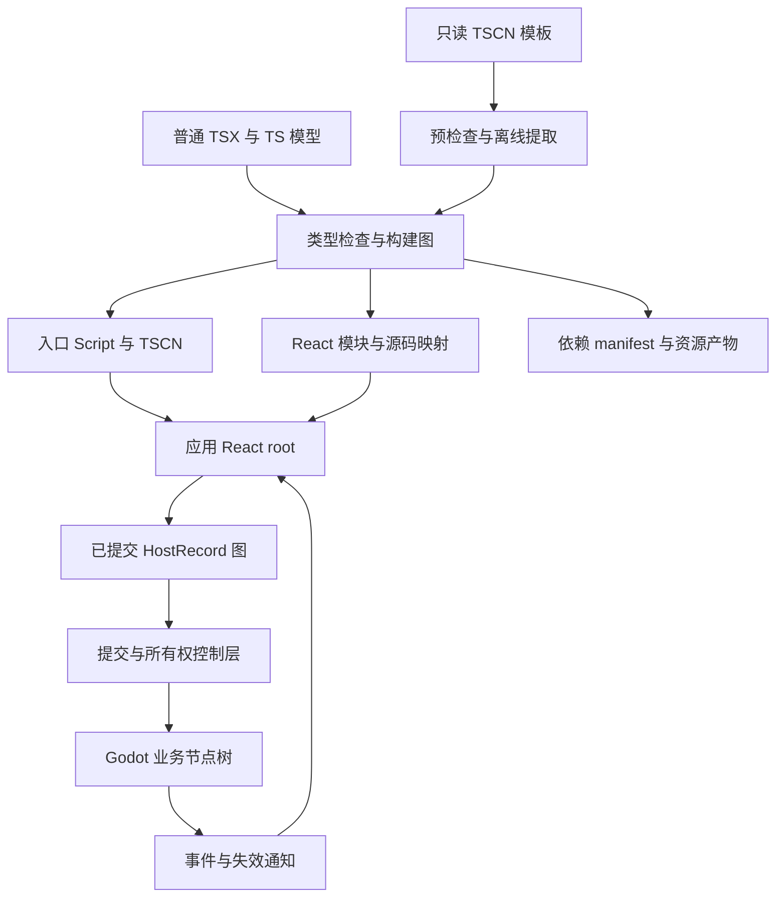
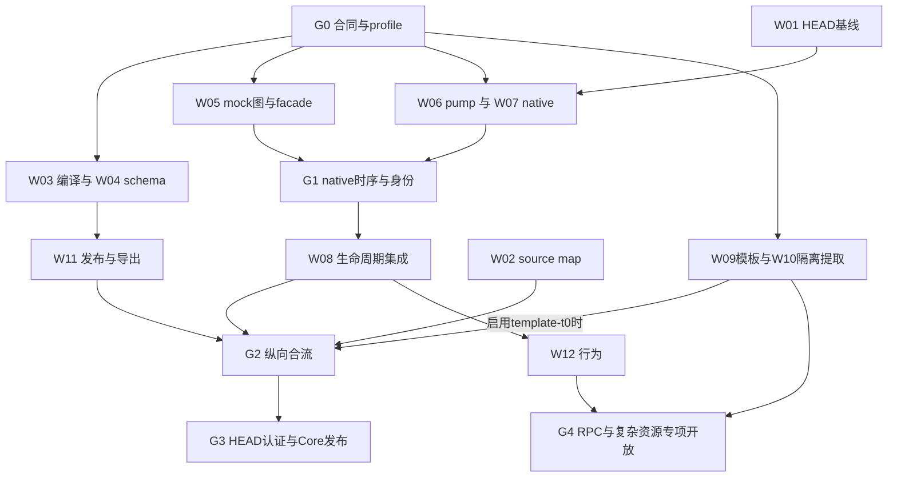

# GodotJS React TSX 实施方案 V2

版本：V2，2026 年 11 月 1 日。源码基线：`b1d8b3f`。状态：经独立架构、运行时、构建、API、QA 与交付评审收敛的实施规格；不是已发布 SDK 的功能声明。

本方案让作者使用普通 React 函数组件与 Hooks 描述 Godot 应用。应用内使用一个 React root；React 已提交的 host graph 是整个应用业务节点树的唯一真值。工具链生成必要的原生 Script、TSCN 入口、模块、资源清单和源码映射。

**开工结论：项目可以整体启动，首批基础实现与有界验证可以并行；全部功能不能立即无依赖编写最终实现。** 本版固定跨模块合同、实际支持 profile、工作包和入口 gate。无需用户继续做内部选型；高级功能按自己的前置条件推进，不用原型通过替代生产验收。

相对 V1，V2 的主要修订是：拆开三道发布屏障；区分只读 ref 与短期写 capability；固定 Host 属性模式；明确 NativeBridge 私有执行/失效协议；冻结模板输入快照和提取环境；指定模板类型入口；用稳定 bootstrap 与启动 ticket 绑定 generation；增加可指派的依赖计划和分层开工判定。

## 1. 已固定的决策

1. 使用真正的 React 和自定义 `react-reconciler` renderer，不另做一套仿 React 响应式框架。
2. 作者不需要编写配对的 Script 类、`defineScene` 或静态场景 DSL。普通 `.ts` 模型、工具和 store 仍可正常复用。
3. 一个应用一个 React root。菜单、关卡、HUD、弹窗和并存场景是同一 React 应用内的组件。
4. 普通组件被登记为独立入口，不改变它在 App 中的 JSX 组合语义，不自动插入原生包装节点。
5. React 唯一决定业务节点的创建、身份、父子关系、顺序和销毁。原生代码通过数据和事件请求 React 改树。
6. TSCN 只作为生成的启动入口、导出依赖载体，或者只读模板输入；不同时维护另一棵可自主变化的业务树。
7. 原生模板导入后，其全部业务节点进入 React 受管模型。运行时不以黑盒 `PackedScene.instantiate()` 作为兼容回退。
8. React 声明属性、一次性初始化值、引擎运行状态分别定义所有权。物理、布局和动画通过受控通道推进状态，不自行改变业务拓扑。
9. 正式公开 API 防止误用，并对绕过 SDK 的外部修改诊断、失效和停止发布；不把 renderer 声明为恶意代码安全沙箱。

## 2. 作者模型

下列包和 API 是拟新增接口。代码表达目标合同，不能直接当作当前仓库已有功能使用。

### 2.1 普通组件与多场景

```tsx
import { useState } from "react";
import { CanvasLayer } from "@godot-js/react";
import Menu from "./scenes/Menu";
import Battle from "./scenes/Battle";
import HUD from "./ui/HUD";
import Dialogs from "./ui/Dialogs";

export default function App() {
  const [session, setSession] = useState<Session | null>(null);

  return (
    <GameProvider>
      {session ? (
        <Battle key={session.id} session={session}
          onExit={() => setSession(null)} />
      ) : (
        <Menu onStart={setSession} />
      )}
      <CanvasLayer>
        <HUD />
        <Dialogs />
      </CanvasLayer>
    </GameProvider>
  );
}
```

相同组件类型、位置和 key 的 props 更新保留 Hooks 状态；key 或类型变化重建该实例。常驻 UI 放在切换分支外。跨父级移动遵循 React 的重新挂载规则，不承诺保留局部状态。

`Context`、场景级 Error Boundary 和 Suspense 沿 React 逻辑树工作。只有逻辑父与物理挂载目标不同时才使用 portal。Godot signals 不自动获得 ReactDOM 的事件冒泡语义。

### 2.2 宿主组件

```tsx
import { useState } from "react";
import { VBoxContainer, Label, Button } from "@godot-js/react";

export default function Counter({ initial = 0 }) {
  const [count, setCount] = useState(initial);
  return (
    <VBoxContainer>
      <Label text={String(count)} />
      <Button text="+1" onPressed={() => setCount(n => n + 1)} />
    </VBoxContainer>
  );
}
```

SDK 导出的是 React host 适配器，不是 `godot.Button` 等原生构造器。公开属性统一 camelCase，事件为 `onPascalCase`；schema 分别保存 publicName、nativeName、binding accessName。旧 GodotJS `.ts` API 的命名不变。构建器生成对应声明，不使用 `Partial<Godot.Node>` 推导 props。反射生成基础签名，命令写入效应、字段别名、特殊布局与安全能力由人工维护的 schema 覆写；不能自动放开全部 Godot 类型。

Fragment、Provider、普通函数组件不生成 Node。原始字符串和数字不隐式生成通用文本节点；文本通过 `Label.text` 或明确的文本包装组件表达。未知属性、只读输出属性、方法冒充属性和不支持的原生类型明确报错。

首版面向同步客户端函数组件；异步资源通过明确的资源接口、lazy 和 Suspense 表达。DOM 组件库、React Native 原生组件、Server Components 不自动兼容这个 Godot renderer。平台无关的状态与 Hooks 库按实际依赖逐项验证。

### 2.3 行为 Hooks 与安全 ref

```tsx
function Player({ speed = 180 }) {
  const body = useNodeRef<"CharacterBody2D">();

  usePhysicsProcess(body, { writes: ["position", "velocity"] }, (commands, dt) => {
    const v = commands.readVelocity();
    commands.setVelocity(vec2(readAxis() * speed, v.y + 980 * dt));
    commands.moveAndSlide();
  });

  useNativeReady(body, node => { /* 原生 ready 与 React refs 均已就绪 */ });

  return (
    <CharacterBody2D ref={body} engineOwned={["position", "velocity"]}
      initial={{ position: vec2(0, 0), velocity: vec2(0, 0) }}>
      <CollisionShape2D shape={capsule} />
    </CharacterBody2D>
  );
}
```

该 Player 是 `behavior-physics` 扩展 profile 的目标 API，不在初始 `core-ui-v1` 发布范围。`useProcess`、`usePhysicsProcess`、`useInput`、`useNativeReady` 由生成驱动器和注册表承接。回调更新使用最新已提交闭包；卸载解除注册。render 只暂存新的 handler/注册/租约描述，layoutPublished 后才生效，被弃 render 不能改变正在运行的回调。每帧回调必须同步，不要求为每次物理更新调用 `setState`。

普通 ref.current 永远返回 `NodeReadHandle`：只能读状态，不能借用其他 Hook 的写租约。frame callback 的第一个参数是新建的短期 `FrameCommands`，绑定 hookId、leaseId/version、目标 NativeKey、RootInstance、OperationEpoch、phase 和唯一 dispatchToken。每条命令重新验证；回调退出后 token 永久失效，捕获到 Promise 或下一个 physics tick 都不能复活。

两种 facade 都没有 `.raw`、`.object`、`add_child`、`remove_child`、`free`、`reparent`、通用 `call/set` 后门。signals、查询和命令返回的 Node 也必须包装；资源使用受限 AssetRef/能力接口，不透传可调用 instantiate 或通用 Object 方法的任意原生 Resource。未知所有权 Node 仅提供只读 NodeId/元数据，不能自动获得写权限。

`engineOwned` 是 Host 生命周期内固定的保留字段集合；`writes` 只申请其子集。两者按 canonical alias 闭包后的集合内容比较，不能按数组引用比较。需要改变字段模式时改变 host key 重建，不在同一对象上原地切换 controlled/engineOwned。

每 Host 首版至多一个带 writes 的 frame registration，其余订阅只读。命令的实际效应按 schema 展开，例如 moveAndSlide 涉及 position/velocity/transform 别名。intrinsic engine-owned 字段由 schema 自动保留，不能被用户覆盖。租约按 commit 统一 release、validate、acquire；不依赖多个 Hook 的 layout 顺序争抢。

类型层尽力拒绝异步 callback，但 `=> void` 可接受 async，擦除后的签名也能绕过泛型检查。运行时检查返回 thenable 并故障化该注册，同时立即撤销 dispatchToken；不能撤销 await 前已经执行的原生写入。每命令 token 检查才是阻止过期写入的最终边界。

### 2.4 模型与资源

局部 UI 状态用 `useState`；游戏模型通过 `useSyncExternalStore` 接入。快照未变化时保持引用稳定，订阅返回取消函数。`useState(model.value)` 只初始化一次，不能冒充订阅。

资源默认按资产身份共享。实例独占资源必须显式声明，并维护该实例内部的别名关系。React key、模板 assetId、运行时 instanceId、网络节点身份分别管理。

`useAsset` 读取准备好的缓存，缺失时通过受控资源任务/Suspense 等待；不在组件 render 中直接调用带行为的 ResourceLoader。请求按资产 ID 去重，异步完成按 scope/generation 校验，取消的旧结果不写回已卸载组件。入口准备只加载必要资源，不因资源 hub 存在就预加载整个项目。

## 3. 系统结构



拟新增两个包：

- `scripts/jsb.react`，发布名 `@godot-js/react`：host 组件、Hooks、facade、reconciler、调度与资源作用域。
- `scripts/jsb.react-build`，发布名 `@godot-js/react-build`：CLI、Program 检查、模板导入、产物与依赖发布、source map。

原生 GodotJS 增加最小的所有权守卫、失效桥、构建 manifest 集成和必要的调度接口。保留旧 `.ts` Script 的身份与默认路径。

### 3.1 版本化合同与实际支持面

跨团队共用的 wire schema、类型和正负 conformance fixture 统一由 W00 落地到 `scripts/jsb.react/src/contracts` 的无 Godot/React 运行依赖子路径。构建器、runtime、原生适配器不得各自复制定义。以下语义在 V2 固定；字段或语义改变提升 ABI/profile 版本并更新 fixture。

| 合同 | 固定内容 |
| --- | --- |
| HostSchemaV1 | public/native/access 名、属性模式、codec、字段 alias/effect、signal echo、内部节点政策 |
| NativeBridgeV1 | NativeKey、RootInstance、exact op、NativeOpResult、失效事件、线程与错误分类 |
| PublicationV1 | NativeApplied、LayoutPublished、PassiveSettled、CleanupReceipt、RootState、BootVerificationReportV1 |
| RuntimeManifestV1 | ABI、认证 tuple、generation、三类图、artifacts/hash/owner、source origins |
| TemplatePlanV1 | snapshot、asset/node/resource ID、父序、owner、codec、来源与拒绝集合 |
| CapabilityProfileV1 | 具体类型/字段/命令/资源/语法白名单及 feature gate，未列即拒绝 |

首个可发布 profile 固定为 `core-ui-v1`，不是“所有 Node2D/Control 均支持”：

| 范围 | 列入目标的能力 |
| --- | --- |
| hosts | Node、Node2D、Control、VBoxContainer、HBoxContainer、Label、Button、CanvasLayer |
| 公共字段 | name、initial、ref；明确的可见性与布局输入；name/engineOwned/nativeScriptProfile 是构造期身份，改动需换 key；没有通用原生方法/属性透传 |
| Node2D | position、rotation、scale、visible、modulate，按有限 transform codec/alias 校验 |
| Control/Container | visible、customMinimumSize、sizeFlagsHorizontal/Vertical、mouseFilter；布局输出自动 engine-owned |
| Label/Button | text；Button disabled、toggleMode、buttonPressed、pressed/toggled；Control focusEntered/focusExited，只在该 signal/echo 策略认证后开放 |
| codecs | bool、有限数值、受范围约束整数/enum、string/StringName、Vector2、Color、profile 指定 AssetRef；任意 Object/Array/Dictionary 不透传 |
| 资源 | 无 Script 的 Resource 数据引用及 CanvasItemMaterial 共享引用；其他 Texture/Theme/动画类型逐项认证扩展 |
| 模板 T0 | 上述 hosts 中已认证的文本 TSCN 子集、已知字段、外部共享资源；其余沿拒绝表 |
| 默认关闭 | portal、LineEdit/IME、physics、per-node Script、RPC、local-to-scene、复杂动画/继承；各自 gate 后开放 |

名单是实现范围，不是当前全部已通过。W04 把每一项展开成逐字段 schema、reset/codec/echo/命令 fixture；W03 消费这些产物。未完成认证的条目不能由 generator 自动开放。新增类不改变核心图协议，通过 profile 扩展。

认证单位固定为 `sourceCommit/sourceDiffHash + GodotVersion/buildFlags + platform/arch + engine + NativeBridgeABI + RuntimeABI + schemaHash + profileHash + React/reconciler/scheduler tuple + mode`。旧 SDK 的成功不自动授予当前 HEAD 或另一 profile 认证。

## 4. 唯一真值与树所有权

### 4.1 精确定义

唯一真值是 React 完成一次提交后的 host graph。每个业务 Native Node 对应一个 HostRecord；每个已物化 HostRecord 对应一个 Native Node。其原生类型、对象身份、名称、公开父子关系和顺序必须与投影一致。

对普通受管父节点：

```text
native.publicChildren(parent) == materializedHostChildren(parentRecord)
```

portal 通过受管 container 明确物理目标和序列范围，不改变组件的逻辑所有权。模板展开、Fragment 扁平化后仍按同一规则审计。首版只开放同一应用内已登记的受管目标，其寿命覆盖全部 portal 子树；向原生祖先、外部应用容器或未受管窗口投送后置。开启 portal 前必须通过带 portal 的关停 gate，不能从普通树退出成功外推。

Godot 的 Viewport 根与启动附着点是平台基础设施。生成入口宿主登记为 RootAttachment。OptionButton、LineEdit 等内建控件自动生成的 `INTERNAL_MODE_*` 子节点属于引擎实现；审计区分 public/internal children，不能把所有 `node_added` 都当作违规，也不能将外来业务节点随意标为 internal 规避治理。

启用该应用 profile 时，doctor 检查项目级业务 autoload/额外 native 场景入口，默认拒绝未迁移的业务 Node root；不能把它们当成第二套兼容树。SDK 明确登记的平台基础设施与非 Node 模型服务单独处理。手工启动的其他应用不隐式加入当前 React root。

### 4.2 HostRecord

```ts
type NativeKey = Readonly<{ slot: number; revision: number }>; // 分别为 uint32
type RootState = "booting" | "running" | "quiescing"
  | "faulted" | "disposing" | "disposed";

interface PreparedHost {
  readonly type: HostType;
  readonly pendingProps: HostProps;
  readonly pendingChildren: readonly HostInstance[];
}

interface CommittedHost {
  readonly hostId: HostId;
  readonly nativeKey: NativeKey;
  readonly publishedCommit: number;
  readonly parent: HostId | ContainerId;
  readonly children: readonly HostId[];
  readonly phase: "published" | "retiring" | "lost" | "freed";
}

interface CommitTicket {
  rootId: RootId;
  rootInstance: string;
  commitId: number;
  buildGeneration: string;
}
```

`PreparedHost` 与已发布图分离，render/appendInitialChild 不修改旧 CommittedHost 的 parent/children/props。每次 commit 建立独立变更图，成功发布后替换快照。记录另有 logical scope、property reservation、event/frame registration、资源、来源位置和 baseline；不是把 mutable desired/current 混在一份对象上。

身份分为 RootInstance（一次应用启动）、NativeKey（原生 lifetime）、OperationEpoch（业务操作取消）、CommitId（提交序号）。完整 NativeObjectID 实际为 Index64，JS ABI 不把它作为普通 number；使用 uint32 pair 或无损字符串。Godot ObjectID、原始地址与 NativeKey 不混用。

render 阶段只创建纯 JS 描述，不构造 Node、不实例化场景、不加载带行为的对象。React 放弃 render 时，没有该子树的原生对象需要回收。资源准备在显式加载通道完成。

节点 name、owner 与 Script 附着属于受管身份/关联，不能绕过提交器更改。core-ui-v1 的 name 为构造属性，同一 HostId 改名要求换 key；不在首版隐式实现原生路径迁移。同级显式 name 冲突给出诊断，不依赖 Godot 自动改名建立协议路径；React key 不自动成为原生 NodePath。模板多实例根名由显式实例 name 或 renderer 确定性实例命名产生，内部相对路径保持；不能静默接受引擎添加后缀。网络路径另要求明确稳定名称。

### 4.3 结构写入许可

只有提交器拥有结构操作权限。正式执行接口是私有 `NativeReactBridge.executeOp(exactOp, rootCapability)`：在 native 内校验 root/lifetime/phase，消费该操作的确切许可，再直接调用目标 Node。操作绑定 opcode、parent、child、index 和 CommitTicket，不把 `grantPermit` 和普通 JSB 方法调用分成两步。

不能仅使用全局 `inCommit=true`：原生 add_child 会触发回调重入，用户代码不能借同一个布尔窗口继续越权改树。GodotJS 桥应检查操作目标和 owned child 参数，并封闭反射、deferred 调用等可绕行通道。

`NativeOpResult` 返回 opId、参数/phase 预检结果、native return/callError、可验证后置条件和诊断。Node add/remove/move 做结构后置审计；已认证属性检查 codec 与存储语义。MethodBind 无 exception 不代表 native void 方法内部没有 ERR_FAIL；无法验证的复杂命令不进入 core profile。getter 回读也不证明 physics/render server 已接受全部副作用。

这是受支持 API 的所有权约束。直接绕过 SDK 的 JS、GDScript、C++ 插件改树属于外部违规。原生信号是事后通知；正式桥负责审计、失效和故障处理，不宣传能够 veto 所有来源的操作。

### 4.4 外部违规处理

发现受管 public children 不一致、对象丢失或非法重挂载后：停止该 root 的业务事件和新发布，撤销写入能力，上报原始 TSX 位置与原生对象信息，进入 faulted 状态。首版采用明确停止和应用级重建策略，不静默采纳外来结构，不以现场原生树反向更新 React。

信号审计存在离树和直接 free 盲区，必须补原生对象失效桥。ObjectDB 在现有写锁内复制 NativeKey/ownerToken、移除、解锁后投递纯数据失效事件；覆盖 `Environment::free_object` 与空 ref 重绑移除路径，不延迟原始指针解绑，不在后台或销毁中的 JS context 调用用户代码。

不能拿着 ObjectHandle 锁进入 Node 回调，也不能在持有写锁时再次调用加锁的 ID 查询。Node 结构操作限定主线程；后台 free callback 只投递完整稳定身份，不携带原指针。失效队列验证 slot reuse、重复事件、关闭竞态，环境销毁后不再回调 JS。已发布 owned Node 禁止动态 set_script/rebind。

若将来要求“阻止任意 GDScript/C++ 在修改前触碰受管树”，需要 Godot Node 层 preflight，属于额外内核改动。不能靠子节点取消 PREDELETE 实现：祖先析构循环可能因此无法推进。

## 5. 属性、事件与错误合同

### 5.0 HostConfig 后端

采用 mutation renderer：`supportsMutation=true`，不启用 persistence 或 hydration。

| HostConfig 操作 | 实现合同 |
| --- | --- |
| createInstance / appendInitialChild | 只建立纯 JS HostRecord 图 |
| append / insert / commitUpdate | 在许可阶段物化、验证和更新原生对象；同父重排用 move_child |
| getPublicInstance | 返回稳定安全 facade，原生对象不外泄 |
| remove / detachDeletedInstance | 逻辑删除并进入完整清理协调，不立即 free |
| clearContainer | 仅清理登记的受管对象，未知 public children 触发故障 |
| hide / unhide | 按认证类型映射可见性，保留对象与资源；不把隐藏等同永久卸载 |

隐藏和 Suspense 不自动暂停物理、音频或所有原生处理。帧注册的 React effect 生命周期、显式 active 状态和字段租约需要联合验证；保留的 Native Node 不因暂时隐藏就自动让出引擎字段所有权。尚未认证的物理/动画与隐藏组合不在支持矩阵中开放。

### 5.1 三类属性

| 模式 | 语义 | 示例 |
| --- | --- | --- |
| controlled | React 持续拥有声明值 | text、disabled、明确传入的 position |
| initial | 物化时赋值一次，之后不参与持续控制 | 物理角色初始位置、模板中的初始资产值 |
| engine-owned | 引擎或受控命令拥有运行状态 | 物理位置、Container 布局输出、动画轨道目标 |

`engineOwned` 是存活期保留掩码，不是当前活跃 lease。尚未安装 Hook、暂时 hidden 或 callback 停止时也不让 controlled 接管。Container 的 size/position 等 intrinsic 布局输出自动加入保留集合；布局输入如最小尺寸、size flags 按 schema 处理。模板属性同样区分初始值与持续控制值。

每次创建/更新先按 canonical 字段集合验证 `controlled ∩ reserved = ∅`、保留掩码未改变，再执行该 record 的 setter。集合按内容比较，initial 按 codec 值/AssetId 比较，不能因为 render 创建新数组/对象就误报。这里是逐 record 前检，不承诺 HostConfig 天然提供整 commit 的 mutation 前全量 preflight。

固定掩码消除了原地所有权切换的循环依赖。Hook intent 只由已提交 layout 注册收集，layout tail 对本 commit 统一 release→validate→acquire；发布失败进入 faulted，不执行 writer，不回滚已经写入的其他属性。未来要同 Host 多 writer 或原地变模式，另提升 profile。

controlled prop 撤销时，恢复物化时记录的不可变实例基线，优先级为显式 initial、模板初始值、schema 默认值。值类型保存快照，资源保存明确的 AssetRef 身份；引擎当前运行值不能反向成为新基线。无合法恢复语义的属性要求显式 reset，不能默默留下过时控制值。更改 initial 在同实例中不重新初始化，开发态给出诊断；需要重置时改变 key。

Resource 以身份比较；值类型按已知 Variant 规则比较和转换。Array/Dictionary 使用显式转换与校验，不依赖原生警告后填 nil/default 的隐式容错。

### 5.2 signals

每个 signal 使用稳定的 Callable/事件槽。连接、断开、队列和对象寿命归 CommittedHost 所有。参数类型来自生成声明，Node 参数映射为只读 handle。

事件 envelope 包含 target NativeKey/root instance、origin、observedCommit、payload 和顺序号。core 至少可靠区分 external 与 controlledSetterEcho；只有经过认证的输入/引擎入口才进一步标为 user/engine，不凭 signal 名猜来源。每 signal schema 固定 echo=suppress/deliver，不能让 controlled setter 无限回环。分不清 echo 来源的 signal 不认证为受控输入通道。

业务事件在 LayoutPublished 且当前 React 执行栈退出后由 pump 派发；若依赖 effect 注册，则等待对应安装屏障。读取 latestCommitted handler，不保留旧 render 闭包。target 退休/丢失或 root instance 改变即丢弃。commit 内产生的 signal 不重入提交；连续事件按明确优先级和批处理进入 React。

### 5.3 错误

render 错误由场景级 Error Boundary 处理。资源准备失败可保持旧场景。commit 失败只能清理本轮明确拥有的新对象、停止有问题的作用域并诊断；不承诺已执行原生 setter、回调、网络或资源副作用的事务回滚。

## 6. 调度、就绪与销毁

### 6.1 安全提交阶段

所有原生树提交经过 NativeCommitGate。允许的阶段是受控的初始离树物化或明确的主线程安全 pump；signal/physics 回调中的 setState 只排队，不直接跨入结构提交。

现有 SDK 的 ScriptLanguage frame/timer 驱动位于绘制之后，不能把“setTimeout 能跑 React”当作正式 pre-draw 调度证明。正式 renderer 使用平台 scheduler 适配，覆盖 reconciler 所需的任务、优先级、yield、timeout 和 microtask 入口，将完整 React 工作安排到运行时安全 pump。禁止只 deferred 每个 setter，随后让 layout effect 误认为原生提交已经完成。

首版可以有界、保守地执行提交；高级并发性能另行认证。保留真实 React 的 Hooks、key、Context、Error Boundary 和 Suspense 合同，不将原生提交包装成异步假提交。

固定三道屏障，禁止使用含混的单一 publish：

| 屏障 | 精确定义 | 允许的动作 |
| --- | --- | --- |
| NativeApplied / mutationCommitted | mutation 与后置审计完成；发生在后续 layout/ref 之前 | layout 读取已应用原生值，暂不派发业务事件 |
| LayoutPublished | 完整 React work stack 返回，refs/layout 完成；框架统一安装 callback/lease | 激活最新已提交 handler，排队派发业务事件/NativeReady |
| PassiveSettled | 对应退休批次的全部同步 passive cleanup 收束，并处理其产生的必要工作 | 签发 CleanupReceipt，允许 pending-free 回收 |

`resetAfterCommit` 只能标记 NativeApplied。reconciler 0.34.0 之后才切 root.current 并运行 layout，所以它不是完整发布点。RuntimeWorkRunner 包住 scheduler callback、sync microtask、初次挂载和显式卸载；最外层 React 栈退出后确认 LayoutPublished，不侵入用户组件。

单次安全 pump 依次处理失效通知、到期工作/同步队列、React 工作与 layout tail、完整 passive/cleanup、可释放批次、已允许事件。新工作按队列迭代，不嵌套进入原生 commit。passive/free 也必须在同一个 gate 内；不能先退出 gate 再 flushPassiveEffects。预算耗尽时保留待清理对象，不为凑帧提前 free；设置有界迭代与积压诊断。

本轮真实 QJS 已验证保留官方 scheduler 算法、仅适配私有 host callback 与 HostConfig.scheduleMicrotask，统一进入 SceneTree.process_frame。生产实现优先该后端，仍需认证 timeout/yield/预算/退出。若目标 HEAD 无法维持该阶段，允许显式认证 after-draw 安全后端并记录显示延迟；禁止逐 setter deferred，也不把 pre-draw 当用户额外硬要求。

### 6.2 就绪状态

分别记录：资源已准备、React commit 已发布、Native ready 已发生、effect 已安装、允许交互。

`useNativeReady` 等待目标 ready 信号和 LayoutPublished 两个条件；信号早于 Hook 注册时读取已记录状态。每次 Hook setup 对该 NativeKey 至多通知一次，可返回同步 cleanup；StrictMode 允许 setup/cleanup 重放。callback 更新只替换最新已提交闭包，不重新 ready；目标 revision 改变则清理旧绑定并等新对象。SDK NodeRef 有明确的目标绑定通知，不能只用稳定 ref 对象引用判断目标变化。

useLayoutEffect/useEffect 不被重定义成 Godot `_ready`，NativeReady 不代表所有资源/effects 或整个 App 已就绪。初次整棵子树尽量离树物化，再进入 SceneTree；不笼统承诺所有后代 `_enter_tree` 都能看到全部兄弟。

### 6.3 删除与清理

```text
标记 retiring、停止事件与新写入
→ React layout/ref 清理
→ 原生 detach 并加入 pendingFree
→ 完整 passive cleanup
→ 回收子树的原生对象和资源引用
→ 清除 registry
```

逻辑写权限与物理存活分开：ref.current 被清空后，cleanup 捕获的 NodeReadHandle 在必要清理窗口仍可读尚存活对象；不能一提升 OperationEpoch 就让所有 cleanup 读操作失败。普通 ref 不因此获得写能力；框架的清理器使用专门 CleanupCapability/订阅句柄执行白名单 stop/disconnect。FrameCommands 不得跨回调保存用于 cleanup。新业务写入与过期异步结果已经禁止。

每次删除生成 RetirementBatch 和 CleanupReceipt，收据绑定 root instance、commit、删除根集合及已完成的 passive 序列。只有 coordinator 可签发；`detachDeletedInstance` 只是观察输入。cleanup 中引发二次提交也要在收据判定中处理，不能把一次 flush 的返回或一个回调等同整批完成。父子回收按删除根去重，重复销毁幂等。

物理 free 的屏障是完整清理阶段结束，不是猜测延迟一帧。异步 effect cleanup 不会被 React await；其任务需要显式取消或代际检查。

外部 free 已发生时，失效桥只能阻止后续访问，不能补回释放前 cleanup。此路径给出 fault 诊断，不宣称与受控销毁等价。退出应用必须在 JS context 仍可用时走 shutdown 协议。

首版明确 launcher 离树即应用结束：生成 root 的 `_exit_tree` 幂等执行 unmount、完整 passive flush、drainFree；正常 SceneTree.quit 已有真实验证。此时后代已离树但尚存活。该规则只针对应用启动根，不推广为每个业务节点 `_exit_tree` 都执行 unmount；不等 Environment.dispose 后才清理用户 effects。

应用主动退出优先通过 SDK shutdown，在普通安全阶段完成清理后再调用原生 quit；launcher `_exit_tree` 是有范围的兜底。含 portal 的目标若正在被原生祖先遍历或已提前销毁，remove 可能失败；此情况需要专门测试和限制目标寿命，不能宣传任意外部容器在退出期间都可同步清理。

### 6.4 暂存与重挂载

首版不提供 KeepAlive 或隐式停车。React 退出分支即卸载。外部 remove/reparent 属于违规，不能无条件在 `_exit_tree` 里隐藏吸收。将来停车由 renderer 明确维护容器、输入、physics、effect 与资源暂停策略；React 跨父级重新挂载仍遵循 React 规则。

## 7. 模板导入与资源语义

### 7.1 管线

```text
只读 TSCN/TRES
→ 冻结内容快照、无执行格式解析与完整资源依赖预检查
→ 无用户 autoload/plugin 的最小临时项目中离线 SceneState 提取
→ 验证 TemplatePlan
→ 生成普通 React 元素模块
→ 每个节点创建 HostRecord
→ 由统一提交器创建 Native Node
```

先检查、后调用 ResourceLoader。即使不 instantiate，load/get_state 也可能加载 Script、资源初始化或触发 CDO。预检查必须覆盖间接资源依赖。原型的规范化文本检查不能作为通用解析器交付。

预检查与提取必须读取同一份冻结 snapshot，而非预检查原路径、稍后再 load 当前文件。发布前 hash 检查无法阻止 TOCTOU 窗口内先执行 Script。parser 从冻结字节收集闭包，复制经允许的资源/UID 映射到最小提取项目；extractor 不回查用户工作树，不以原项目的 autoload、@tool 或编辑器插件启动。需要的 importer 设置和原生构建 tuple 写入 snapshot。该隔离 backend 的 UID/import 等价性是独立 spike。

运行时没有源 TSCN 也应能运行，不能回头读取模板修正树。模板组件根就是模板实际根，没有额外宿主。`owner` 是序列化关联，不是 React 生命周期 owner。

### 7.2 首版白名单

| 内容 | 首版处理 |
| --- | --- |
| 已认证内建节点、已知属性、名称/顺序/相对路径 | 支持，并建立逐节点 HostRecord |
| 已知无 Script 的共享外部资源 | 支持，维护显式依赖与别名 |
| Script、用户 Resource、不可分析代码 | 构建失败；行为迁移到 Hooks 或生成桥接 |
| 继承、嵌套实例、占位实例 | 初版拒绝；后续离线展开并验证资产语义 |
| 持久连接 | 初版拒绝；后续转为受管事件注册 |
| local-to-scene | 初版拒绝，不能用普通 duplicate 冒充等价 |
| 复杂动画、method track、自动生成业务节点的插件 | 拒绝或专项适配 |
| 不透明二进制场景/资源 | 初版拒绝 |

每增加一种能力，都添加原生等价性用例。local-to-scene 后续必须验证跨实例克隆、同实例别名和 get_local_scene；AnimationPlayer 后续需要解析轨道 NodePath、登记属性租约，method track 需要单独允许的行为通道。

TemplatePlan 仅描述静态可序列化数据：assetId、sourceHash、节点 ID/类型/父/顺序/属性/owner、资源图、来源位置。它不是另一套公开 UI 运行时；运行时全部落到 React 元素与统一 HostRecord。

### 7.3 类型与导入形式

首版固定配置登记 assetId 后生成普通可解析模块，例如 `@project/react-templates/panel`；CLI setup 生成专属模块、声明和 TypeScript paths。用户按普通组件导入，不写场景 DSL。模板预扫、Plan 和资产专属 props 类型先于完整 TypeScript Program。

TemplateProps 仅包括该根已认证的 props、name、initial 与只读 ref；不开放任意 children 或内部路径 overrides。相对 `.tscn` import 是后续语法糖，需明确 CompilerHost 与 IDE/语言服务或声明策略，过 gate 前不给全局 `*.tscn:any` 兜底。原型使用 `ComponentType<{}>`，仅证明零参数模板；资产专属 props 与错误跨模板 props 是新增验收。

## 8. 原生行为与完整能力路线

### 8.1 process、physics、input

生成 App 驱动器提供真实 `_process`、`_physics_process` 和输入入口，按有效 scope 和目标对象分派。回调必须同步，按 NativeKey/RootInstance/OperationEpoch 校验，卸载解除注册。初版确定排序为 SDK priority、HostRecord preorder、Hook ordinal；同级稳定，不宣称与任意旧 Node Script 的原生排序完全相同。

顺序、优先级、pause/process_mode 和进入树状态是显式合同。全局驱动器不能免费复现所有旧脚本回调相对任意原生插件的交错顺序；正式行为通道声明自身执行阶段。physics 回调只运行已授权命令，结构更新排队到安全提交阶段。

UI 控件继续使用 Godot 原生焦点和 GUI 输入，signal handler 不自动冒泡。`useInput/useUnhandledInput` 定义 active scope、目标 Viewport、优先级和 handled 状态；只在当前输入阶段开放标记 handled 的能力。受控文本更新避免重复写入已相等的值，专项验证焦点、光标、选择区与 IME；key 重建时不承诺保留旧控件焦点。

需要严格遵循每节点原生回调顺序、process priority/mode、thread group 的功能，采用生成 host Script 原型 stub 转发到 registry 的后端，不插入额外 Node。stub 继承正确原生 leaf，保持项目内独立默认类和 Script 身份；可与 RPC 后端共用。旧 Script 已占用同一个 host 的情况不直接叠加，必须迁移或专项适配。线程组执行不能直接跨线程调用 React；支持范围在该后端认证后开放。

host Script ctor 必须在物化前确定，按 `(nativeLeaf, interfaceSchemaHash, behaviorProfile)` 选择。不能等 Hook effect 才对已发布对象 set_script：现有绑定可能移除旧 NativeObjectID 并重新绑定。动态 Script 升级、不可解析目标、改变活动 interface schema 都不进入首版。

### 8.2 exports 与原生接口

入口 props 以普通 React 参数表达。需要 Inspector 或原生调用时，仅对可序列化、可分析的输入生成 schema 和 Script exports；callback props 保持运行时 JS，不序列化进 TSCN。

公开信号和方法通过显式 schema 生成桥接。原生组件 class/JS wrapper 能力单独建模，不能仅凭 TSCN 原生根类型承诺完整 JS API。

### 8.3 RPC

RPC 使用静态可分析的 schema 加每实例 handler registry。编译器生成真正默认导出的 NativeScript 类、原型 stub 和 RPC metadata，stub 按对象 ID/epoch 调用已注册处理器。任意闭包不能直接作为原生 RPC 方法。

静态 schema 在 materialize 前关联到具体 host 并选择生成 ctor，Hook 只在 LayoutPublished 后更新 handler registry；构造与 metadata 验证先 spike，随后才做真实联网。动态 schema、无法绑定目标、活动 endpoint 名称/path 变更在首版拒绝。此扩展不能反向改变 core-ui-v1 的 NativeIdentity 合同。

协议固定方法名、参数、authority、transfer mode/channel，以及确定的网络节点路径；React key 不作为全局网络 ID。传输使用明确 DTO/codec 与稳定网络 ID，不传递本地 Node/handle。原生 rpc 调用的本地 Error/发送状态与业务 request/reply 分开；需要远程响应时定义 requestId、超时和取消协议，不宣称 RPC 自动返回远程 Node。schema 无法静态确定时构建失败。

既有 SDK 缺少完整联网模块。RPC 只有 metadata 证据；必须在带 SceneMultiplayer/ENet 的目标 GodotJS 构建中做真实 server/client、authority 拒绝和重连验证，才能开放正式功能。

## 9. 编译、产物与依赖

### 9.1 入口配置

使用构建配置登记稳定 entryId、模块和导出符号；目录约定可以作为便捷方式。配置不改变组件源码的 React 语义。独立运行依赖 App Provider 或必填 props 的组件，使用普通 React preview 入口补齐环境。

entryId 和模板资产身份保存在可版本管理的配置/ID 元数据中，不放入可删除的 `.godot` 缓存。源码路径重命名更新映射，不改变同一原生入口的逻辑身份；原生 UID 与生成路径一并校验。React key 只在同级标识实例，不复用为资产 ID 或 RPC 全局身份。

生成入口 TSCN 是应用启动器，不承诺作为透明 Native Prefab 嵌入旧场景。启动宿主是明确的平台附着层，原生 current_scene 指向该 App；普通 `<Battle />` 不增加这一层。需要原生可嵌入资产时走受管模板或另行认证稳定根投影，不能隐式套通用 Node/Control。

### 9.2 产物布局

```text
src/App.tsx
src/scenes/Battle.tsx
godot-react.config.mjs
generated/react/
  entries/app.ts
  scenes/app.tscn
  resource-hubs/app.tres
  export-hubs/app.tscn
  active.json
  manifests/<generation>.json
  templates/panel.tsx
  templates/panel.d.ts
.godot/GodotJS/
  generated/react/entries/app.js
  react-build/<generation>/views/*.js
  react-build/<generation>/*.js.map
```

只有真正 NativeScript 入口和生成行为 stub 拥有独立 `.ts` 身份。普通 TSX 函数组件不生成伪 Script；不创建与作者 TSX 同目录同名的 `.ts`，避免 TypeScript 静默选择错误源文件。

原型为兼容旧 SDK 所用的额外身份标记是验证适配，不是正式产物设计。正式版以 manifest 管理所有 JS、map、TSCN 和资源的归属，替换仅凭 `.js → .ts` 猜测的清理逻辑。

RuntimeManifestV1 至少固定 schemaVersion、generation、sourceSnapshotHash、compilerVersion、runtimeAbi/nativeBridgeAbi/entryInterfaceHash、Godot/engine/schema/profile tuple、mode、React tuple、entries、modules/resources/nativeScripts、artifacts 与 sourceOrigins。路径统一 canonical res URI，拒绝越界、大小写冲突和 source/output 冲突。

稳定 bootstrap 只保存 entryId 和 ABI，普通业务 build 不覆盖其代码。launcher TSCN 只嵌 entryId/generation/ABI；active descriptor 保存 manifest 路径和 digest。manifest 的 artifacts 不包含自身、active 和 journal，避免自引用 hash。generation 为唯一构建 ID，不要求等于最终 manifest hash；sourceSnapshotHash 不包含生成产物。

实例进入树时校验三者一致，只读一次并取得 GenerationTicket。view/template 模块路径含不可变 generation，SDK/React 按 runtime ABI 保持单例。Ticket 在实例生命周期固定，不跟随 active 指针漂移；ABI/入口接口变更强制重启对应 Godot 执行环境，不能靠模块 reload 冒充。

### 9.3 构建顺序

1. 请求受控停止 SDK 管理的运行/preview，等待全部 RunLease 释放后取得跨进程独占发布锁，冻结源码、模板、lockfile、配置与 schema snapshot。
2. 模板预扫与类型准备，生成 Plan/专属模块/声明，再建立完整作者 TypeScript Program。
3. 检查普通 TSX、平台合同与三类依赖，标准 JSX 编译，生成候选 Script/TSCN/hub/manifest/maps。
4. staging 校验代码闭包、ABI、路径、hash 与 generation，安装候选全部字节，包括已写好 generation metadata 的 launcher；此时保持启动/导出锁定，不能运行 metadata 与旧 active 不一致的入口。
5. EditorFileSystem 扫描、原生 import 完成，校验实际产物及资源 hash，封存 manifest。
6. 最后仅提交 active descriptor/READY 标记，doctor 校验一致后释放发布锁，才开放运行/导出。此步不再修改任何已扫描和封存 artifact 的字节。

状态机固定为 `LOCKED → SNAPSHOTTED → EMITTED → MATERIALIZED → SCAN_IMPORT_PENDING → IMPORTS_VERIFIED → MANIFEST_SEALED → ACTIVE_COMMITTED → READY`。不能先 active 再 import。

V0 不让活实例跨业务发布继续运行；watch 完整关停后重启。原生资源只承诺启动/导出时的 snapshot/import hash 一致，不承诺历史 live generation 穿越资源重导入仍冻结。崩溃后启动仅信完整 descriptor，metadata/manifest 不匹配则拒绝；恢复可重建旧完整代或保持封锁重建新代，不能无条件宣称旧资源仍可运行。失败构建不发布半代产物，也不静默隐藏失败。

启动以共享 RunLease 原子读取并验证 ticket，lease 持有至实例关闭；publisher 取得独占 lease 后才更改入口/原生资源，不能只先检查一个 lock 文件。无法受控关闭的外部实例使 build 返回 E_RUN_ACTIVE，不强杀未知进程。原子替换、进程崩溃释放和 journal 恢复先在目标平台认证；无该能力的平台不得降级为无锁热切换。ABI 改变时重新创建相关 JS/Godot 环境，保留旧 SDK module cache 不算重启。

cleaner 共享 staging/journal、sealed/active 与运行持有代的产物归属索引，发布锁内不回收候选 JS；不能只看旧 active 就删除刚写入、尚未 seal 的 TSX 输出。中断代先恢复 journal，再回收已确认由编译器拥有且无人持有的文件。原生 importer 缓存仍由其自身规则管理，不递归删除用户资源。

### 9.4 React 单例与模块

本轮基准组合为 React 19.3.1、reconciler 0.34.0、scheduler 0.28.0。正式 SDK 锁定配套版本并以该组合回归，不随意使用浮动版本。

作者 `react`、`react/jsx-runtime`、`react/jsx-dev-runtime` 与 renderer 必须解析到同一个 canonical React 实例。dev/prod 分支在构建期固定，不能把依赖 process.env 的 npm 默认入口原样交给无 process 的运行时。

普通 React 代码可以打包；真正 NativeScript 保持独立 module 身份，不能随意内联到普通 bundle。旧 `.ts` 的模块路径与身份保持兼容。manifest 静态追踪依赖，不通过执行组件推导模块图。

### 9.5 资源与 PCK

资源 hub 是纯数据引用，不创建业务节点，也不要求运行时预加载全部资源。生成后先经过原生文件扫描和 importer，不能用导出期复制原始 SVG 等文件替代导入产物。

为生成入口实现 manifest 驱动的原生资源依赖；代码闭包由 exporter 明确携带。首版认证导出入口固定为 CLI：preflight→临时 PCK→空 cwd SDK 启动验证→配置的业务验证（若有）→发布最终包。`EditorPlugin::build()` 返回 bool，可作为 F5/预览门禁；其进程接口需有退出码与构建结果。`EditorExportPlugin._export_begin` 是 void，默认 GUI 不可绕过硬门禁单独 spike，不能把 ERROR/warning 当导出已中止。

selected-scenes 模式必要时使用独立 export-hub.tscn 作为扫描根，引用 resource hub。export hub 不运行、不进入应用树。把 `.tres` 直接放进仅选 scenes 的列表，不保证它会成为有效根。

SDK 自动提供 BootVerificationReportV1，含 entryId/generation/认证 tuple、首个 LayoutPublished、树审计、已请求的必要资源与未预期错误；业务无需自行打印测试 sentinel。它只证明框架启动与已覆盖资源，不自动证明游戏玩法或未执行分支。持续运行/交互/网络项目通过专门验证入口或 CI 用例完成业务断言，未配置时报告明确标记 boot-smoke 范围。

测试 fixture 仍使用明确成功标识配合行为断言；正式工具检查 SDK 报告、模块/资源日志、包目录和项目验证结果。出口码 0 不能单独证明发布成功。动态资源路径必须来自可分析导入或登记目录，未知字符串路径给诊断。

## 10. 编辑器与调试

启用 React 的项目使用可配置的统一 `godot-react watch`；未启用项目保留旧 tsc 流程。入口 TSCN 可以作为运行/预览启动器，但不能手工增添业务 children 后继续当作合法受管应用。旧资产编辑通过模板源输入完成，再重新生成。

首版使用完整重建/重启，明确重置局部 React 状态。独立 preview 是另一个应用入口，不承诺复制任意 App Context。嵌入式工具预览需要独立生命周期和关闭清理，后续实现。

source map 是首版可发布门槛。当前 SourceMap 解码与查找存在标准 fixture 不符的证据：generated column/source index delta、GLB 查找、unmapped 段。需要先修算法并加标准 fixture，再验证 TSX→生成代码→JS 的组合映射；同时处理 stack 的 1-based/0-based 与非法索引。QuickJS 无列号时只做有证据的行级映射；一行多源无法确定时保留原 JS frame，不伪造精确位置。默认不压缩作者代码。仅生成 .map 文件不足以保证定位正确。

最低诊断包含 entryId、build generation、component/模板来源、HostRecord ID、NativeObjectId/revision、操作和执行阶段。React DevTools、完整 Godot 脚本 debugger 能力另行建设，不与基础错误定位混为一项承诺。

### 10.1 现有项目迁移

1. 安装运行时与构建包、登记 App/preview 入口；旧 `.ts` 模块路径保持。
2. 将旧 Script 的模型提取到普通 TS/store，原生生命周期行为迁移为 Hooks 或生成接口；不自动翻译任意旧脚本。
3. 将场景按白名单作为只读模板导入，或直接写宿主 JSX；含 Script/复杂继承等输入先明确诊断，不退回黑盒实例化。
4. 迁移原生 NodePath、信号、网络名与资源作用域。入口宿主改变路径时显式调整，不能声称与旧树绝对路径完全兼容。
5. 将 main_scene 指向生成入口，跑完整树审计、退出与 PCK 验收。旧 native 系统若仍能自主改业务树，需要迁移到 React 数据/事件通道后才能纳入该应用。

## 11. 仓库改动分解

| 位置 | 实现内容 |
| --- | --- |
| 新 `scripts/jsb.react` | host schema、组件、Hooks、facade、HostRecord、提交/事件/资源/清理 |
| 新 `scripts/jsb.react-build` | CLI、Program、模板 importer、manifest、依赖与 source map |
| `scripts/jsb.editor/src/jsb.editor.codegen.ts` | 输出可写属性输入、signal 元组、值类型和能力声明 |
| `weaver-editor/jsb_editor_plugin.cpp` | 统一 watch、manifest 归属清理、构建状态与扫描 |
| `weaver/jsb_resource_loader.cpp` | 生成入口的 manifest 依赖发现 |
| `weaver-editor/jsb_export_plugin.cpp` | 显式代码/资源/Script 闭包和导出 preflight 集成 |
| `internal/jsb_path_util.cpp` | 保留旧路径，新增生成 Script 身份映射边界 |
| 新 `bridge/jsb_react_bridge.*` | 私有 exact-op 入口、root capability、NativeOpResult 与稳定失效事件适配 |
| `bridge/jsb_environment.cpp` 及对象绑定 | owner registry、结构操作守卫、对象失效队列与调度接口 |
| `weaver/jsb_script_instance.cpp` | 生命周期桥接与 shutdown；不粗暴删除 PREDELETE 过滤 |
| `internal/jsb_source_map.cpp`、cache、debugger | 标准算法、映射链与 TSX 路径 |
| `tests/project`、`scripts/test/run-runtime-matrix.mts` | 标准 TSX、受管模板、生命周期、PCK 与引擎矩阵 |

生产安全 pump 若不能通过现有 SceneTree 阶段实现，增加最小原生调度接口；全来源修改 veto 若被要求则单独列 Godot core 补丁。两者不能隐藏在“纯 TS runtime”工作量里。

## 12. 开工、依赖与交付计划

### 12.1 分层判定

| 判断对象 | 当前结论 |
| --- | --- |
| 项目整体立项、核心开工 | Ready；主架构不再选型 |
| W00 合同落地、HEAD 基线、source-map、测试设施 | 可立即开始 |
| 其他基础模块 | 可按 V2 在分支准备代码/fixture；合并真实跨包实现前必须通过 G0 |
| 各团队均有可做工作 | 可以；部分工作是 schema、mock 和有界 spike |
| 全部功能同时写最终生产实现 | 不可以；高级能力存在真实前置依赖 |
| 合并 | 每工作包独立 gate，实验功能默认关闭，不回归旧 TS 项目 |
| 发布 | 尚未就绪；通过 G3 后才开放 core profile，扩展按 G4 逐项开放 |

V2 已确定产品和内部语义，W00 将其落实为可编译 types/schema/fixture。G0 之前不得各自硬编码另一套 DTO。P0—P3 表示范围，不表示所有包可以同步开始生产集成。

### 12.2 可指派工作包

Ready 表示可以据本规范开始该工作；Conditional 表示正式集成依赖上游 gate，可以先做接口和 fake-backend；Spike 表示先证明指定结论，不能直接铺开全部功能。

| 包 | 状态与输入 | 输出、改动归属 | 前置与验收 |
| --- | --- | --- | --- |
| W00 合同/profile | Ready；V2 六组合同 | contracts 子路径、schema versions、错误码与正负 fixture；单一合同 owner | G0：各消费方解析同一 fixture，未知字段/ABI/profile 拒绝 |
| W01 HEAD 基线/QA | Ready；当前源码和旧测试 | 可追溯 Godot 4.6.1 构建、QuickJS/V8 matrix、独立 harness、认证 tuple | 先证明旧 TS 基线；跨包 gate 由此执行，不沿用未知 SDK 认证 |
| W02 source map | Ready；四个既有失败 fixture | decoder/GLB/unmapped、索引安全、栈坐标、map 组合测试 | 标准 fixture、非法输入、旧 TS 与真实 TSX 定位；不牵涉 runtime 实现 |
| W03 编译/manifest | Ready；G0 DTO/entry/profile | jsb.react-build 的 Program、canonical resolver、静态三类依赖与 emitter | 缺 JSX/错误 props/路径冲突拒绝；不能执行组件发现依赖 |
| W04 schema/类型 | Ready；G0 core-ui-v1 | codegen、host props/codecs/echo/构造属性、readonly AssetRef | 每字段正负例、reset/alias/类型范围，无通用透传 |
| W05 图/facade/events | Ready，先用 fake NativePort | Prepared/Committed、只读 handle、事件队列、字段保留与 lease、RootState | 依赖 G0/W04；aborted render 不污染 current，旧 cap 拒绝，局部 key 正确 |
| W06 RuntimePump | Conditional；最小 QJS spike 已通过 | 私有 scheduler adapter、microtasks、三屏障、预算/timeout/shutdown | G0/W01；G1 验证全部入口同 gate、layout 在 native 后、passive/free 不逃逸 |
| W07 NativeBridge | Conditional；exact-op/NativeKey ABI | JSB 结构守卫、原子身份移除、后台失效队列、重绑限制 | G0/W01；先证明锁序/重入/slot reuse/context disposal，再集成 |
| W08 生命周期集成 | Conditional；W05/W06/W07 | NativeApplied/LayoutPublished/Receipt、shutdown、fault、只读/cleanup 权限 | G1；无 premature free，无重复销毁，计数回基线；当前 HEAD 实测 |
| W09 模板前端 | Ready；G0 Plan/W04 codecs | 严格格式 parser、冻结闭包、T0 拒绝集、专属模块/类型 | 脚本/间接脚本/未知资源拒绝；跨资产错误 props 拒绝 |
| W10 隔离提取后端 | Spike→Conditional；W09 snapshot | 最小临时项目、白名单 UID/import、SceneState→Plan | 不启动用户插件/脚本；TOCTOU 负例不执行 marker；未过则关闭模板 feature |
| W11 发布/编辑器/导出 | Conditional；W03/G0 | RunLease、staging/journal、EFS seal、bootstrap pin、cleaner、F5、CLI/PCK | 正确状态机、失败/中断/重命名/混代与目标平台进程锁；统一 native editor 文件 owner |
| W12 行为/input | Conditional；W08/W04 | App main-thread dispatcher、NativeReady、输入和短期 Commands profile | phase/token、同步回调、固定排序、active 门控、卸载后停止 |
| W13 per-node/RPC | Spike；W08/NativeScript ABI | 构造前生成 leaf ctor/metadata、handler registry、真实双端原型 | 不动态 set_script；先 ctor/身份，再网络/authority/channel/路径 gate |
| W14 复杂资源/导入 | 分子 profile 的 Spike | local-to-scene、动画 effect、继承/嵌套 Plan、专项 fixtures | 各自依赖 W09/W10/W12；等价性未过继续拒绝，不以 duplicate/展平降级 |

W03 拥有编译与 manifest；W09 拥有模板 parser，W10 拥有原生 extractor；W11 统一修改 editor/export/loader，避免多包同时改同一原生插件文件。W07 拥有 Environment/ObjectDB/binding 守卫，W06 优先在运行时 adapter/生成 launcher 接入 pump，不并行私改对象数据库。每包负责自己的测试，W01 负责跨包认证与证据。

### 12.3 集成 gate 与关键路径



- **G0**：六组 wire schema、profile、错误码与 conformance fixture 统一落地；没有未决定的跨层 ID/生命周期字段。
- **G1**：目标 HEAD 的 pump、重入许可、线程失效/重用与完整 cleanup 收据证明。旧 SDK spike 是可行性证据，不替代 G1。
- **G2**：正式实现的 TSX→模板/资源→PCK、树审计、事件/退出、混代与错误定位合流。模板在合流验收中独立证明；未通过可以发布不含 template-t0 的 core，但不能称模板迁移已完成。
- **G3**：QuickJS/V8 的精确 tuple、旧 TS 回归、资源计数和正式 CLI 导出通过。development/production 分别认证；dev StrictMode 验证 callback/ref/lease 重放幂等与未提交原生分配为零。source-map 必须正确；JSC/Web 未认证时明确不开放。
- **G4**：per-node Script、RPC、physics、local-to-scene、动画、复杂导入按各自 profile 独立验收，不共用一个模糊“高级功能完成”标识。

首批并行是 W00/W01/W02，加 W03/W04/W05/W09 的骨干和 W06/W07 的有界验证；G0 后正式对接类型。关键路径是 G0/W01→W06/W07→W08→G2→G3。无需等待所有高级能力才让 core 开发。

### 12.4 有界验证的产物与停止条件

| 验证 | 必须交付 | 未通过时的处理 |
| --- | --- | --- |
| pump/发布 | scheduler+sync lane、NativeApplied/layout、passive/free、timeout/预算的实际时序 | 不接业务 native mutation；可明确认证另一安全阶段，不 deferred 单独 setter |
| NativeIdentity/guard | 原子移除/重绑、slot reuse、后台通知、操作重入和 shutdown conformance | 停止扩大 host 覆盖，不用 tree signals 冒充完整失效桥 |
| 模板隔离 | 冻结 snapshot、无用户 autoload/plugins、UID/import 正负例 | 模板 feature 关闭；parser/schema 工作继续，无黑盒回退 |
| portal 退出 | 同应用目标的寿命、blocked/退出/重复清理测试 | portal 保持关闭，普通 CanvasLayer/Viewport 嵌套继续支持 |
| ctor/RPC | 物化前身份/metadata、真实双端 authority/channel/重连 | 只保留 schema/fixture，不开放联网功能 |
| local/动画/继承 | 资源别名、实例归属、轨道 effect、原生继承意图等价性 | 明确拒绝，不以浅克隆/最终树快照静默替代 |

全来源 native veto、动态 Script 升级、线程组、HMR/Fast Refresh、KeepAlive、任意 React 全树静态抽取和旧脚本自动转换不属于第一轮最终实现。它们可准备设计/fixture，不能以“全部开工”名义跳过依赖。只支持 UI 的阶段也不能宣布完整替代全部 TS+TSCN。

## 13. 验收与发布门槛

1. **标准链路**：真实 TSX、标准 JSX runtime、两个场景、常驻 HUD、资源，经 selected-scene PCK 在空目录运行；缺 JSX runtime、Script 身份或导入产物均判失败。SDK boot report 与 fixture/项目业务断言分开判定。
2. **唯一树**：props/key/列表/模板更新后逐节点审计 public Node 图；没有多余宿主；被弃 render 原生分配为零；内部引擎节点不误报。
3. **寿命**：refs 清理、事件失效、三屏障/完整收据、重复销毁、旧异步回调、slot/revision 重用、外部 add/remove/move/free 的支持范围分别测试。
4. **调度**：signal 重入、初次 ready、process/physics 更新、安全阶段、任务饥饿和预算有可观察顺序；layout 不先于真实原生提交。
5. **字段与能力**：controlled/initial/engine-owned 冲突、属性撤销、Variant 转换、safe handle 返回值与信号参数、动态反射入口均有负例。
6. **模板**：运行时移走源模板仍运行，全部节点受管，路径/顺序/变换/资源别名正确；脚本依赖在 ResourceLoader 前拒绝；未知语义不静默降级。
7. **构建一致性**：重命名、构建失败、孤儿清理、半产物和混代、source map 标准 fixture 通过。
8. **真实运行环境**：以完整认证 tuple 在当前源码 HEAD 的 QuickJS/V8 认证；JSC/Web、物理、IME、联网分别按已通过能力声明，不能由 Node/mock 结果替代。
9. **资源计数**：暖机后重复 mount/unmount、失败、换 key 和 shutdown，owned HostRecord/Native binding、Callable、订阅、任务、AssetRef 的持有计数回到基线。它不等于全局 heap 字节归零或完整 GC 泄漏证明。
10. **判定严格性**：正向成功要求行为断言、唯一树审计、成功标识、无未预期 script/module/native 错误及产物审计同时成立；负例按预期错误码失败。捕获错误与字体等已知环境警告分开，不能只检查 exit0 或总 passed 字段。

core 的行为 gate 包括真正的引擎 GUI 输入路由到 Button、React 状态与可见属性更新，不能仅用 pressed.emit 代替。LineEdit/IME、真实碰撞、联网分别按扩展 gate 验证。资源计数按 owned scope 和已暖机缓存定义基线，不要求用户故意持有对象或全局缓存强制归零。

## 14. 验证证据与未完成项

历史实验已证明真实 React 的 Hooks、Context、key、局部 Error Boundary/Suspense、多场景与发布基础路径。旧的“PackedScene 黑盒+Mount”实验不满足现有整棵树受管要求，只作为局部机制证据保留。

本轮重点验证如下；复现目录位于 `/workspace/work`，交付证据汇总另存 JSON。

| 目录 | 观察 | 边界 |
| --- | --- | --- |
| `round14-vertical` | 4 个标准 TSX 作者模块，严格完整 Program 零诊断；canonical React/JSX runtime；真实 QJS 多场景与 6 个业务节点审计；509,764 B selected-scene PCK 空目录运行通过 | 构建发布原型，不是正式编译器；显式清理屏障，source map 未实现 |
| `round14-vertical/combined` | 标准 TSX 导入两节点 TSCN 后生成普通 TSX 组件；8 个业务节点、6 次全树审计；511,132 B PCK 空目录运行；原模板及 remap 不在包内，生成模块在包内 | VBoxContainer/Label 的严格文本子集，非通用 parser；调度/map 等限制同基础实验 |
| `round14-vertical` 负例 | 缺 JSX runtime 时 exit 0 但模块报错/无成功标识；错误 text 类型被拒绝；无效资源选择根会漏资源 | 证明必须校验行为、模块和资源，不能只看退出码 |
| `round14-prefab` | 源模板移走后运行；两实例共 8 个受管节点；无 envelope；运行时 instantiate=0；路径/变换/共享资源正确 | 四个 Node2D 的有限白名单；不证明通用导入 |
| `round14-prefab` 负例 | Script 与间接带 Script 资源在 load 前拒绝，初始化 marker 不产生 | 规范化文本子集检查；正式需格式 parser |
| `round14-behavior` | 真实 process/physics 回调、闭包更新、卸载停止、安全 handle、严格类型正负例 | SDK dummy physics，不证明碰撞和完整租约实现 |
| `round14-ownership` | tree/order 信号可审计入树/部分离树修改；直接释放存在盲区 | 不能证明全来源 veto；原生桥尚待实现 |
| `round14-ownership` shutdown | launcher `_exit_tree` 正常 unmount/passive/free，cleanup 时对象有效，children 清零 | 仅证明正常 App 退出；不覆盖任意业务 child 外部 free |
| `round14-build` | 当前 source-map C++ 原算法的四个标准 fixture 不符 | 独立算法测试，不是完整 Godot debugger 测试 |
| `round15-qa` | 隔离复制后独立重编译、真实 QJS、selected-PCK/空 cwd 与负例复跑通过；8 业务节点、6 次审计、511,132 B；原报告/source hash 未变；正向日志无 runtime 错误 | 不认证目标 HEAD；发现原型 passed 未纳入 scriptErrors 的判定缺口，正式 CI 已列加强要求 |
| `round15-runtime` | 真实 QJS 同时将 scheduler host 与 sync microtask 纳入 process_frame pump；layout 读取已更新 native；用户 timers 不变 | 仅最小 adapter spike；未证明预算、timeout、多引擎、原生 guard/失效桥 |
| `round15-api` | TS6 证明 void 可擦除 async，JS 模型证明 dispatchToken 过期后不能借后续 tick 写入 | 类型/能力模型，不是已实现原生权限桥 |
| `round15-build` | Node CJS 复现覆盖稳定入口仍用旧缓存；只读一次 ticket 与不可变 generation 路径可 pin 实例 | Node 缓存模型与源码核对，不是 Godot/跨平台原子发布认证 |

实际原生实验使用现有 Godot 4.6.1 custom QuickJS SDK，与源码基线对应关系未知；官方 Godot 4.6.3 仅用于部分原生语义对照。生产 scheduler、原生失效桥、正式模板 parser、完整 host schema、多引擎认证、GC/泄漏统计仍是实现与验收工作。

在这些门槛通过前，方案应以“已验证骨干与完整实施规格”交付，不把原型等同于可发布 SDK。

## 15. 评审结论与变更闭环

六个独立方向的评审一致认可核心可以开工，没有新增需要用户决定的架构问题。V2 不再用“已有可行性验证”概括所有模块已达到同一种就绪程度。

| 评审发现 | V2 处置 | 开工影响 |
| --- | --- | --- |
| resetAfterCommit 早于 refs/layout | 三屏障、RuntimeWorkRunner、CleanupReceipt | W05/W06/W08 共用协议后对接 |
| prepared/current 可互相污染 | 不可变 prepared 与 committed 工作图分离 | 图核心可先用 fake port 开工 |
| ref 可借租约，async/cap 可逃逸 | ref 只读，短期 Commands、thenable 与 token 运行校验 | 类型/API 可开工；不依赖 TS 线性类型幻想 |
| 同节点字段模式交接有循环依赖 | engineOwned 生命周期固定，改模式 key 重建，每 record 前检 | 先实现保守 profile，不先做动态多 writer |
| 失效桥遗漏 rebind、锁序/64位ID风险 | exact native op、完整 NativeKey、原子移除/重绑守卫、线程队列 | W07 先 conformance，不能仅补 signal 审计 |
| active 指针不等于实例 pin/import 就绪 | 稳定 bootstrap、RunLease、generation ticket、import后封存再active | W11 可按明确状态机实现，平台锁/崩溃 gate 必须过 |
| 模板检查后可变，用户工程可能自带代码 | 冻结闭包与最小提取项目，专属类型先于 Program | 前端可并行；隔离 backend 有界 spike |
| 总 passed/exit0 与 sentinel 过强 | 严格日志/行为判定、SDK boot report 与项目测试分层 | W01/W11 共同验收，不要求用户手写SDK测试输出 |
| P0—P3 不能直接指派并行工作 | W00—W14、G0—G4、单文件 owner、停止与降级合同 | 整体开工 Ready；全部功能无依赖最终实现为 No |

正式执行顺序是先提交 W00/W01/W02，再并行推进骨干与有界验证；G1 通过后集成 native 生命周期，G2/G3 通过后发布精确 core profile。高级功能可同步做 schema/fixture/spike，未过 gate 不进入默认功能面。该判断支持现在启动项目，不支持把全部高级特性一次性当作已完成设计的生产任务派出。
